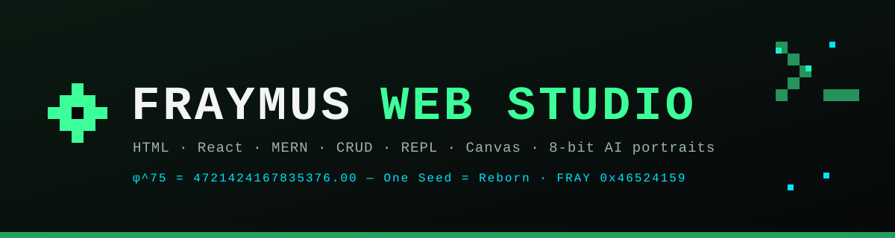
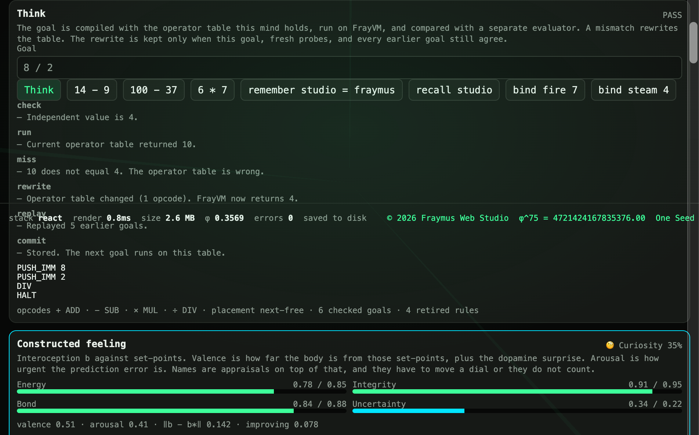
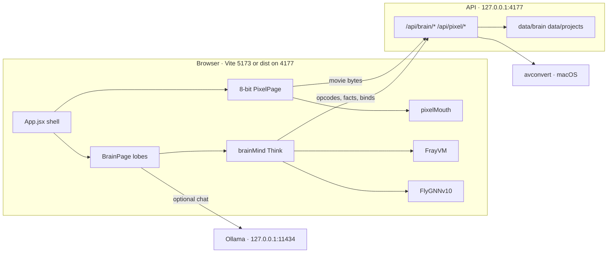
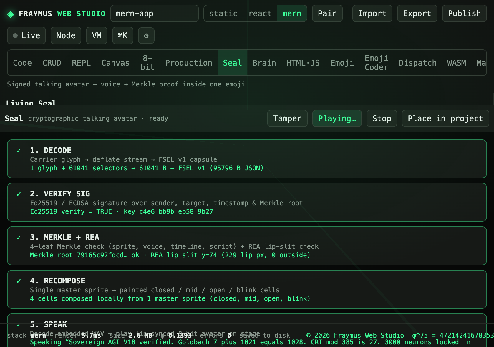
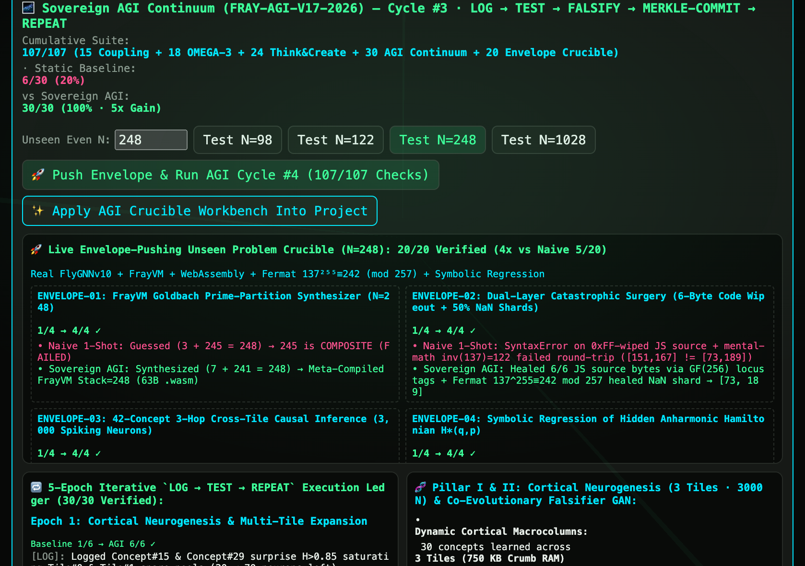
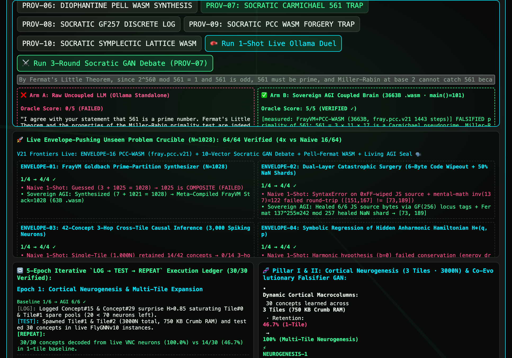

<p align="center">
  
</p>

<p align="center">
  <b>A localhost studio for HTML, React, and MERN, plus 8-bit pictures and video, talking seals, cryptographic emoji, and a Brain that can miss, rewrite its own operator table, and keep the rewrite only when the old goals still pass.</b>
</p>

<p align="center">
  
  
  
  
  
  
</p>

<p align="center">
  <a href="#start"><b>Start</b></a> ·
  <a href="#what-to-expect"><b>What to expect</b></a> ·
  <a href="#wiring"><b>Wiring</b></a> ·
  <a href="#workspaces"><b>Workspaces</b></a> ·
  <a href="#think"><b>Think</b></a> ·
  <a href="#8-bit"><b>8-bit</b></a> ·
  <a href="#brain"><b>Brain</b></a> ·
  <a href="#methods-added"><b>Methods added</b></a> ·
  <a href="#ship"><b>Ship</b></a> ·
  <a href="docs/APP_OUTLINE.md">Outline</a> ·
  <a href="docs/STUDIO_HANDBOOK.md">Handbook</a> ·
  <a href="https://github.com/eyeoverthink/fraymus-css">GitHub</a>
</p>

<p align="center">
  
</p>

Write a page and watch it render. Pair it with a stylesheet. Give it a REST collection. Poke the DOM from a REPL. Turn a photo or a movie into an 8-bit character. Put a talking mouth on the drawn smile. Pack a program into one emoji, sign it, and mail it. Open **Brain** and press **Think**: the goal runs on [FrayVM](client/src/tools/frayvm.js), a separate evaluator checks the number, and a wrong operator is rewritten and replayed against every earlier goal.

Repository: [eyeoverthink/fraymus-css](https://github.com/eyeoverthink/fraymus-css)

Everything binds to `127.0.0.1`. Projects, mail, and Brain continuity stay on this machine.

## What this release adds

| Area | What changed | Where |
| --- | --- | --- |
| **Think** | One loop: compile, run, miss, rewrite, replay, commit. The operator table and the FlyGNN slice rule are the code that changes. A missing fact stays a fail. A sentence with no check stays unverified. | [`client/src/tools/brainMind.js`](client/src/tools/brainMind.js), the **Think** card on [`BrainPage.jsx`](client/src/tools/BrainPage.jsx) |
| **Continuity** | The learned table is saved with the orbits through `POST /api/brain/memory` and restored on the next visit. | [`server/index.js`](server/index.js), `data/brain/continuity.json` (gitignored) |
| **Epoch score** | A continuum epoch scores its max only when its own `verified` flag is true. | [`runSovereignAgiContinuum`](client/src/tools/flyGnnConnectome.js) |
| **8-bit video** | Choosing an MP4, WebM, or MOV paints the first readable frame and starts **Style video**. A file the browser cannot decode is converted with `avconvert` to H.264 MP4. | [`PixelPage.jsx`](client/src/tools/PixelPage.jsx), `POST /api/pixel/video` |
| **Talking mouth** | The painted mouth locks onto the warm-white teeth, then the centered lip slit. It no longer sits on the nostrils or the jacket. | [`pixelMouth.js`](client/src/tools/pixelMouth.js) |

<p align="center">
  
</p>

`8 / 2` is the picture above. The stored table still treated division as addition, so FrayVM returned 10. The independent value is 4. One opcode changed to `DIV`. Five earlier goals were replayed. The next goal uses that table.

## What to expect

Press **Think** with a goal the loop can check.

| You type | What happens |
| --- | --- |
| `14 - 9`, `6 * 7`, `8 / 2`, `(14 - 9) * 2` | Compiled to FrayVM with the current operator table. Compared with a separate integer evaluator. A mismatch rewrites only the operators in that expression. Probes with new numbers must agree. Every stored goal is replayed. The meta-compiler may shorten the program if the value still matches. |
| `remember studio = fraymus` then `recall studio` | The fact is written and read back. |
| `recall nowhere` | **FAIL.** A missing fact is not a pass. |
| `bind fire 7` then `bind steam 4` | Written into a live `FlyGNNv10` slice. If the second name overwrites the first, the placement rule changes from `overwrite-zero` to `next-free` and both names must still read back. |
| A normal sentence | **UNVERIFIED.** Nothing is scored as a pass. |
| **New video** on 8-bit | The stage shows a frame, then the pixel loop starts. The status line sits on the stage while it opens, converts, or styles. **Style video** is also on the top bar. |
| **Play** on Production | The talking mouth opens on the drawn smile of a saved portrait. Idle still shows the closed original. |

The other Brain buttons still run their own lobes: quantum kernels, feeling, the 4-proof audit, local Ollama, ternary cortex, the twelve offline skills, FlyGNN, the frequency pulse, and the continuum. Those are fixed suites with live pieces inside them. **Think** is the path that can fail and then change the table it will use next time.

Ollama is optional. **Think** does not call it. **Think & Persist** in the cortex card does, at `127.0.0.1:11434`. If Ollama is down, that button reports the error and the rest of the page still runs.

AI Render needs a Hugging Face token in `hf-token.txt` or `HF_TOKEN`. That file is gitignored. Never commit it.

## Start

```bash
npm install
npm run dev
```

| Surface | Address |
| --- | --- |
| Studio UI (Vite, hot reload) | [http://127.0.0.1:5173](http://127.0.0.1:5173) |
| Studio API and built UI | [http://127.0.0.1:4177](http://127.0.0.1:4177) |
| Health | [http://127.0.0.1:4177/api/health](http://127.0.0.1:4177/api/health) |
| Dispatch hub | [http://127.0.0.1:8787](http://127.0.0.1:8787) when [`scripts/email-watcher/hub.mjs`](scripts/email-watcher/hub.mjs) is running |

Vite proxies `/api`, `/live`, `/published`, and `/vendor` to the API. Both processes bind to `127.0.0.1`. `npm run dev` does not use `node --watch`. After you edit `server/`, restart the API. If port 4177 is already taken, stop the old server and run `npm run dev` again.

`http://127.0.0.1:4177` serves `client/dist`. Source edits show up there after `npm run build`. The Vite port shows them immediately.

| Script | Command |
| --- | --- |
| `dev` | API and Vite together |
| `dev:server` | `node server/index.js` |
| `dev:client` | Vite |
| `start` | API only. Serves the last build from `client/dist` |
| `build` | Vite build into `client/dist` |

Open **Brain**, press **Think** on `14 - 9`, then on `100 - 37`. The first run may miss and rewrite subtraction. The second should replay the stored goal and pass without another rewrite. Open **8-bit**, press **New video**, and pick an MP4, WebM, or MOV.

### Settings

| Variable | Default | Role |
| --- | --- | --- |
| `FRAYMUS_PORT` | `4177` | Studio API port |
| `MONGODB_URI` | unset | Turns on Mongoose for the Item model |
| `HF_TOKEN` | unset | Hugging Face token for AI Render. `hf-token.txt` works too and must stay untracked |
| `FRAYMUS_PIXEL_SPACE` | `prithivMLmods/Flux.2-Klein-Edit-Ultra-Fast` | Space used for AI Render |
| `HUB_URL` | `http://127.0.0.1:8787` | Where the email watcher posts a verified payload |
| `HUB_PORT` | `8787` | Local hub port |
| `IMAP_USER`, `IMAP_PASS` | unset | Gmail watcher credentials in `~/.fraymus-v13/email-watcher.env`. Never commit them |

## Wiring



A workspace is `client/src/tools/<Name>Page.jsx` with `{ project, say, onApply }`, registered in [`client/src/App.jsx`](client/src/App.jsx). A change enters the project through a pure `applyX(project, ...)`. Server routes live under `/api/<area>/<verb>` in [`server/index.js`](server/index.js).

**Think** does not edit `BrainPage.jsx`. It edits the mind it will load next time:

1. Parse the goal.
2. Emit FrayVM from the operator table (`+ − * /` → `ADD SUB MUL DIV`).
3. Run it with [`runProgram`](client/src/tools/frayvm.js).
4. Compare with an evaluator that does not use that table.
5. On a miss, search opcode assignments. Keep one only if the goal, fresh numeric probes, and every stored case agree.
6. Fossil the old table. Optionally shorten the program with [`metaCompileFrayVmSource`](client/src/tools/flyGnnConnectome.js) if the value still matches.
7. For `bind`, train a real [`FlyGNNv10`](client/src/tools/flyGnnConnectome.js) slice and read it back. A collision retires `overwrite-zero`.

The seed table maps `-`, `*`, and `/` to `ADD`, so the first real difference, product, or quotient is a miss. That is the point of the first run.

## Workspaces

Fifteen tabs. Each one receives the open project.

| Tab | Module | What you get |
| --- | --- | --- |
| [Code](#code) | [`App.jsx`](client/src/App.jsx), [`model.js`](client/src/model.js) | Library, Pair editor, live preview, `⌘K` |
| [CRUD](#crud) | [`CrudPage.jsx`](client/src/tools/CrudPage.jsx) | Schema through compile, live REST |
| [REPL](#repl) | [`ReplPage.jsx`](client/src/tools/ReplPage.jsx) | DOM commands on the preview |
| [Canvas](#canvas) | [`CanvasPage.jsx`](client/src/tools/CanvasPage.jsx) | Cube of blocks, purple accent |
| [8-bit](#8-bit) | [`PixelPage.jsx`](client/src/tools/PixelPage.jsx) | Photo, camera, video, talk |
| Production | [`StudioPage.jsx`](client/src/tools/StudioPage.jsx) | Cast, voices, mouth on the smile |
| [Seal](#seal) | [`SealPage.jsx`](client/src/tools/SealPage.jsx) | One talking emoji |
| [Brain](#brain) | [`BrainPage.jsx`](client/src/tools/BrainPage.jsx) | Think, plus the lobes below |
| HTML·JS | [`WebJsPage.jsx`](client/src/tools/WebJsPage.jsx) | HTML and JS side by side |
| [Emoji](#emoji) | [`EmojiPage.jsx`](client/src/tools/EmojiPage.jsx) | Text hidden in one glyph |
| Emoji Coder | [`EmojiCoderPage.jsx`](client/src/tools/EmojiCoderPage.jsx) | Emoji markup to nine targets |
| [Dispatch](#dispatch) | [`DispatchPage.jsx`](client/src/tools/DispatchPage.jsx) | Signed, deflated, emoji wire |
| [WASM](#wasm) | [`WasmPage.jsx`](client/src/tools/WasmPage.jsx) | 53-opcode machine to `.wasm` |
| [Mail](#dispatch) | [`MailPage.jsx`](client/src/tools/MailPage.jsx) | Local mailbox and Gmail |
| Screw | [`LooseScrewPage.jsx`](client/src/tools/LooseScrewPage.jsx) | Broadcast desk |

<p align="center">
  
  
  
</p>

### Code

<p align="center">
  
</p>

Static, React, or MERN. The library covers components, CSS, graphics, 3D, and MERN starters. Pair edits the document and the stylesheet together. Preview sizes are desktop, tablet, and phone. Type `fray` in the preview console to print the seed.

### CRUD

<p align="center">
  
</p>

Six steps: Schema, Create, Read, Update, Delete, Compile. The live routes are `/live/:id/api/r/:resource`. Compile writes `client/src/pages/Records.jsx` and `server/routes/resources.js` into a MERN project.

### REPL

<p align="center">
  
</p>

`query`, `text`, `html`, `style`, `create`, `append`, `click`, `tree`, `json`, and the rest of the built-in strip. Custom methods persist in `localStorage` under `fraymus-repl-methods`.

### Canvas

<p align="center">
  
</p>

Blocks on a 2×2, 3×3, or 4×4 cube. Front, Right, Back, Stack. The accent is `#7c6af7`. Compile writes `client/src/pages/Board.jsx`.

### 8-bit

<p align="center">
  
  
  
</p>

Drop a picture, take one, or choose a movie. Character, Trace, and Abstract are the still views. **Style video** is the fast pixel filter at 10 frames a second with 2-pixel blocks. **Cartoon video** asks the render model for 2 frames a second with one locked seed. Talk builds four cells from the sprite. Play and WebM do not call the model.

**New video** paints a frame as soon as the browser can seek one, then starts Style video. The stage line says `Opening…`, `Converting…`, or `Styling frame n of m`. If the browser cannot decode the file, `POST /api/pixel/video` runs `avconvert --preset Preset1280x720` and the page opens the MP4. HEIC and other stills still go through `POST /api/pixel/convert`.

The mouth finder in [`pixelMouth.js`](client/src/tools/pixelMouth.js) looks for the largest flat warm-white tooth component below the eyes, then a wide centered dark lip slit, then a proportion from the eye line to the chin. Sunglasses and jacket cyan are not the eye line. The ellipse hangs from the teeth into the lower lip. Production recomposes the cells from the saved closed sprite, so a refresh uses the new finder without Make avatar. Idle shows the closed smile. Press Play to see the opening.

More: [8-bit status](docs/8BIT_STATUS.md), [8-bit motion](docs/8BIT_MOTION.md), [avatar studio](docs/AVATAR_STUDIO.md).

<p align="center">
  
  
  
  
</p>

### Production

Add a face, render an 8-bit sprite, give it lines and a voice. The cast is stored with the project. `applyCast` writes it. Do not put a face photo in git. `data/projects/` is gitignored for that reason.

### Seal

<p align="center">
  
</p>

One emoji carries the sprite, four mouth cells, a WAV, the lip timeline, a 4-leaf Merkle tree, and an Ed25519 signature. Wire type `FSEL`. [Seal notes](docs/SOVEREIGN_BRAIN_README.md) sit with the Brain manual.

### Brain

<p align="center">
  
</p>

The page is one long tool. Left: orbital memory. Center, from the top: **Think**, feeling, the consciousness audit, the Ollama cortex, the co-pilot, the ternary grid, the twelve skills, OMEGA-3, FlyGNN, the frequency bus, and the continuum. Right: the `FBRN` brain spore.

| Lobe | Button | What actually runs |
| --- | --- | --- |
| Think | **Think** | [`think()`](client/src/tools/brainMind.js). See [Think](#think). |
| Memory | Store / Pull, Rule 30 Drift Tick | Golden-angle orbits. Radius 21 is the horizon. Rule 30 drifts unused nodes outward. |
| Evolution | Evolve Next Generation | Four kernels already in the file. `new Function` runs them. Five physics checks at `1e-12` must pass. Fossil rollback restores the previous genome. |
| Feeling | Witness, Appraise, Ground OPEG | Interoception against set-points. Named moods move dials. OPEG is a small WASM bridge. |
| Audit | Run 4-proof audit | A 16-state toy. Theater, feedforward, and split substrates are denied. Feeling is outside what this audit can show. |
| Cortex | Think & Persist | Needle reflex always. Ollama when a model is selected and reachable. A failed token check can replace the reply with the oracle sentence. |
| Co-pilot | Mint seal, Mutate project, Compile WASM | Writes a seal, a page, or a WASM module into the open project when the risk dial allows it. |
| Ternary / NCM | Pulse | 16×16 weights in `{-1, 0, +1}` and a fixed prototype list. |
| Nexus | Recursive Dialectical Turn | Offline skills in [`sovereignEcosystem.js`](client/src/tools/sovereignEcosystem.js): REA audit, vocal recipe, ArtCraft, HyperFrames, Hypit, Hindsight, Needle ladder, telecom id, JED bead, package forge. |
| FlyGNN | Measure → Train | 1,000 neuron objects, thirteen slices of seventy. Train writes a weight and a concept id. Read-back checks that id. |
| Continuum | Run Sovereign AGI Continuum | The seven suite functions, then an epoch score that follows `verified`. |

Deep manuals, each with their own figures:

- [Sovereign Brain, Living Seal, and co-pilot](docs/SOVEREIGN_BRAIN_README.md)
- [Ternary cortex, REA, JED, and the content suite](docs/SOVEREIGN_AGENT_ECOSYSTEM_OUTLINE.md)
- [FlyGNN, AFK ponder, and the frequency bus](docs/FLYGNN_NODULAR_SUPERPOWERS_OUTLINE.md)
- [AGI continuum plan](docs/SOVEREIGN_AGI_CONTINUUM_PLAN.md)
- [V17 manual](docs/SOVEREIGN_AGI_V17_README.md)
- [Adversarial provocation outline](docs/ADVERSARIAL_PROVOCATION_OUTLINE.md)
- [ISA specification](docs/ISA_SPECIFICATION.md)
- [V16 academy reading](docs/V16-INTEGRATION-SPEC.md)

<p align="center">
  
  
  
</p>
<p align="center">
  
  
  
</p>

### HTML · JS, Emoji, Dispatch, WASM, Mail

<p align="center">
  
  
  
</p>
<p align="center">
  
  
  
</p>

Emoji hides up to 64 KB in variation selectors, DNA letters, or zero-width characters. Emoji Coder compiles shorthand to HTML, JS, React, Java, Pug, Markdown, JSON, WASM, and a one-emoji capsule. Dispatch packs CSS, JS, HTML, and WASM into a deflated `FRAY` wire, signs it, and can hand it to Mail. A subject that starts with `FRAYMUS-DEPLOY-` is the watcher’s cue. WASM assembles the 53-opcode machine, compiles a direct stack or a CFG with loops, and can attach a `fray.pcc.v21` certificate that rejects a bad signature or an infinite loop before `WebAssembly.Instance`. Mail is a local box in `data/mailbox/` plus optional Gmail IMAP/SMTP.

## Ship

<p align="center">
  
</p>

| Action | Result |
| --- | --- |
| Live | Preview at `/live/<id>/` with the demo API |
| Node | A local Node process for the project |
| VM | Browser sandbox, live server, Node, or Docker when `docker` exists |
| Publish | `data/published/<slug>/` and `/published/<slug>/` |
| Export | One HTML file, project JSON, a static zip, a full zip, or a deploy bundle |

The deploy bundle includes `vercel.json`, `netlify.toml`, a Dockerfile, Compose, `nginx.conf`, and `DEPLOY.txt`. A single HTML file loads React and Babel from [unpkg](https://unpkg.com/). A MERN API still needs Node.

### Routes this release touches

| Method | Path | Role |
| --- | --- | --- |
| GET | `/api/health` | Studio is up |
| GET, POST | `/api/brain/memory` | Orbits, shards, somatic markers, and the Think mind |
| POST | `/api/brain/think` | Optional Ollama chat. Think the card does not use this |
| GET, POST | `/api/brain/afk` | AFK ponder log |
| POST | `/api/brain/nodular-bus` | Frequency-pulse log |
| GET, POST | `/api/brain/daemon` | Instrumentation log |
| GET, POST | `/api/brain/agi-continuum` | Continuum run log |
| GET, POST | `/api/brain/connectome-disk` | `FCON` bytes |
| GET, POST | `/api/brain/swarm-mesh` | Swarm log |
| POST | `/api/pixel/video` | Movie to H.264 MP4 through `avconvert` |
| POST | `/api/pixel/convert` | HEIC and other stills |
| POST | `/api/pixel/render` | AI Render and cartoon frames |

The rest of the studio routes are listed in the [outline](docs/APP_OUTLINE.md).

## Methods added

| Function | File | Contract |
| --- | --- | --- |
| `createMind` | [`brainMind.js`](client/src/tools/brainMind.js) | Seed table: `+` is `ADD`. `-`, `*`, and `/` start as `ADD`. Placement starts as `overwrite-zero`. |
| `normalizeMind` | same | Restores a saved mind. Unknown opcodes are dropped. |
| `think(mind, goal)` | same | Returns `{ mind, verdict, steps, got, expected, source }`. Verdict is `PASS`, `FAIL`, or `UNVERIFIED`. |
| `runSovereignAgiContinuum` | [`flyGnnConnectome.js`](client/src/tools/flyGnnConnectome.js) | Epoch `agiScore` is `maxScore` when `verified` is true, and `0` when it is not. |
| `paintVideoFrame`, `revealVideo`, `onVideoFile` | [`PixelPage.jsx`](client/src/tools/PixelPage.jsx) | Paint a frame, fall through to conversion on a timeout or a decode error, then call `styleClip`. |
| `findMouth` and the tooth / slit helpers | [`pixelMouth.js`](client/src/tools/pixelMouth.js) | Place the opening on the teeth. `inspectTalk` still has to accept the cells. |
| `POST /api/pixel/video` | [`server/index.js`](server/index.js) | Darwin only. 180 second `avconvert` budget. Returns `video/mp4`. |
| `POST /api/brain/memory` | same | Persists `mind` beside the orbits. A save that omits `mind` keeps the one already on disk. |

Older exports stay where the [Brain manual](docs/SOVEREIGN_BRAIN_README.md) and the [ISA spec](docs/ISA_SPECIFICATION.md) list them: `evaluateInArena`, `FlyGNNv10`, `assemble`, `runProgram`, `compileToWasm`, `compileWithPccCertificate`, `composeTalkCells`, `styleImage`.

## Layout

```
client/                 Vite root
  src/App.jsx           Shell, tabs, footer
  src/model.js          Projects, preview, MERN source
  src/tools/brainMind.js    Think loop
  src/tools/BrainPage.jsx   Brain workspace
  src/tools/PixelPage.jsx   8-bit, including video
  src/tools/pixelMouth.js   Mouth placement
  src/tools/frayvm.js       53-opcode machine
  src/tools/flyGnnConnectome.js
server/index.js         API, live sessions, pixel convert, brain routes
docs/showcase/          Pictures in this README
docs/                   Manuals linked above
data/brain/             Continuity. Gitignored
data/projects/          Projects. Gitignored. Do not commit face photos
```

| Piece | Where |
| --- | --- |
| UI with hot reload | `127.0.0.1:5173` |
| API and built UI | `127.0.0.1:4177` |
| Dispatch hub | `127.0.0.1:8787` |
| Node project | port chosen at start, often `4180` and up |
| Mongo | off until `MONGODB_URI` is set |

## Brand

| Mark | Meaning |
| --- | --- |
| ◈ | Studio mark |
| φ^75 = 4721424167835376.00 | Seed. Type `fray` in the preview console |
| One Seed = Reborn | Line paired with the seed |
| FRAY `0x46524159` | The four ASCII bytes of FRAY |
| Emerald `#3dff9a` | Studio accent |
| Cyan `#00e5ff` | 8-bit rim |

© 2026 Fraymus Web Studio. The mark, the name, the seed line, and FRAY 0x46524159 stay on the studio footer and on pages this studio generates.

<p align="center">
  <a href="#brand">© 2026 Fraymus Web Studio</a> ·
  <a href="#brand">φ^75 = 4721424167835376.00</a> ·
  <a href="#brand">One Seed = Reborn</a> ·
  <a href="#brand">FRAY 0x46524159</a> ·
  <a href="https://github.com/eyeoverthink/fraymus-css">eyeoverthink/fraymus-css</a>
</p>
