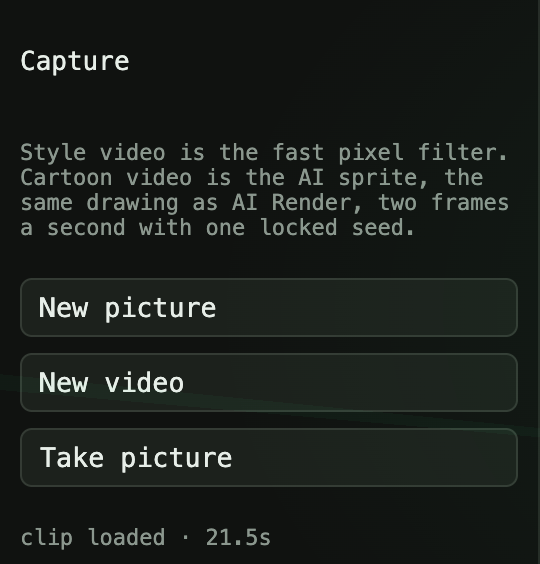
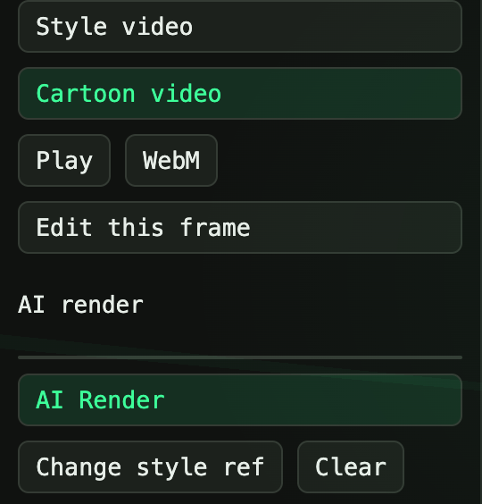
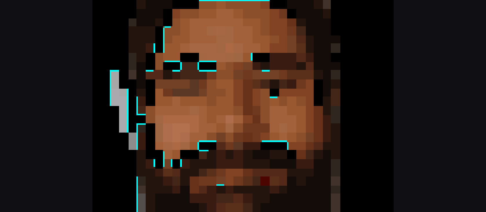

# Chapter — 8-bit status

Current as of 17 October 2026. This chapter is the state of the 8-bit workspace in [Fraymus Web Studio](../README.md). It does not replace the README. The stills, the camera, and both video paths below are in the app.

Related chapters:

- [README · 8-bit studio](../README.md#8-bit-studio) — the short tour and the still images
- [8-bit motion](8BIT_MOTION.md) — camera, Style video, and Cartoon video, step by step
- [Avatar studio](AVATAR_STUDIO.md) — what is next: one sprite, a frame buffer, a voice track

## What the workspace does now

Open **8-bit**. A photo becomes a pixel portrait. A webcam can be filtered live. A video can be filtered, or redrawn as a cartoon sprite.

| Path | What it uses | What you get |
| --- | --- | --- |
| **AI Render** | Hugging Face, FLUX.2 Klein, `/api/pixel/render` | One still. About 7–10 seconds. **Real outfit** keeps the clothes. **Avatar** uses the studio costume. |
| **Character, Trace, Abstract** | The offline filter in `pixelEngine.js` | The same still, restyled without another model call. |
| **Take picture** | The webcam, then the offline filter | A live stage. **Shutter** stores the full frame for Edit, AI Render, PNG, and Place. |
| **Style video** | The offline filter, 10 frames a second | A pixel video of the whole clip. Fast. The picture stays photographic, so fine detail looks grainy. |
| **Cartoon video** | The same model as AI Render, 2 frames a second, one locked seed | A flat sprite: hard edges, solid colors, black background, cyan rim. This is the drawing that matches the still AI portrait. |

  
  

The still views (photo, Real outfit, Avatar, Character, Trace, Abstract) stay in the [README](../README.md#8-bit-studio). The motion frame below is a public clip, not a private photo.

  

Test frame from <a href="https://commons.wikimedia.org/wiki/File:20140529_-_Smiling.webm">20140529 - Smiling.webm</a> by Clément Bucco-Lechat, <a href="https://creativecommons.org/licenses/by-sa/3.0/">CC BY-SA 3.0</a>.

## Style video

**Style video** seeks the whole clip at 10 frames a second. Nothing is dropped. Each frame is scaled to 480px on the long edge. The square follows the band of the frame that has facial detail, so a flat wall does not become the picture. Blocks are 2 pixels. Frames are kept up to 720px and the WebM is written at a high bitrate so a player does not blur the edges. The file length is written into the WebM, because a browser recording otherwise opens as 0:00.

This path is the one to use for a live camera and for a quick pixel pass. It is not the cartoon. A 2-pixel grid of a real photo still reads as a grainy photograph.

## Cartoon video

**Cartoon video** is the path that matches the AI still. Each sampled frame is a head-and-shoulders JPEG. That JPEG is posted to `/api/pixel/render` with the current mode (**Real outfit** or **Avatar**), the style reference if one is set, and a note that the character, palette, hat, and clothes stay put. The first response's seed is sent with every later frame.

A 21.5 second phone clip is 44 frames at 2 frames a second. Each frame takes on the order of 7 seconds, so the clip is a few minutes of rendering, then playback is instant. **Play** and **WebM** use that 2 fps rate. **Stop** keeps the frames already drawn. The saved file for that test was `fraymus-8bit.webm`, 44 frames, 22 seconds.

Real outfit plus a style reference keeps the clothes in the video and copies the drawing of the reference. That is how a yellow jacket stays a yellow jacket while the picture becomes the flat sprite. Avatar replaces the clothes with the studio costume.

Private photos and phone videos used to judge this path are not in the repo. The demo person in the README is AI-generated.

## What is deliberately not live

The model is not in the camera loop and not in playback. A still is about 7 seconds. A camera that waited on that would not be a camera. Style video can keep up because the filter is local. Cartoon video finishes the frames first, stores them, and only then plays.

That split is the reason for the next chapter. Calling the model once per frame, even at 2 fps with a locked seed, still lets the face drift, and it spends a model call for every moment of the video. The avatar people can reuse is one approved sprite, plus a small buffer of mouths and poses drawn from that sprite. [Avatar studio](AVATAR_STUDIO.md) is that outline.

## Files

| File | Role |
| --- | --- |
| `client/src/tools/PixelPage.jsx` | The workspace: stills, camera, Style video, Cartoon video, Play, WebM |
| `client/src/tools/pixelEngine.js` | Mask, face band, crop, the offline filter, `portraitPhoto` |
| `client/src/tools/pixelMotion.js` | Frame grab, 10 fps filter, 2 fps cartoon input, seek, WebM duration |
| `client/src/styles.css` | `.pixel-clip` keeps the decoder element decoded without showing it |
| `server/index.js` | `POST /api/pixel/render` — FLUX.2 Klein, seed, style image, real or avatar |
| [8BIT_MOTION.md](8BIT_MOTION.md) | The steps |
| [AVATAR_STUDIO.md](AVATAR_STUDIO.md) | The next build |
