# Outline — Fraymus Web Studio

The full map of the studio as of 18 October 2026. This chapter does not replace the [README](../README.md). The README stays the tour. This page is the index of everything that tour now includes: the original editor, mail, the 8-bit stills, the camera, Style video, Cartoon video, Talk, and Production.

Repository: [eyeoverthink/fraymus-css](https://github.com/eyeoverthink/fraymus-css)

| Chapter | What it covers |
| --- | --- |
| [README](../README.md) | The tour, the still pictures, and the API reference |
| This page | Every workspace, in one place |
| [8-bit status](8BIT_STATUS.md) | What the 8-bit paths do today |
| [8-bit motion](8BIT_MOTION.md) | Camera, Style video, Cartoon video, and Talk, step by step |
| [Avatar studio](AVATAR_STUDIO.md) | Why the talking avatar is one sprite plus a buffer |
| [Studio handbook](STUDIO_HANDBOOK.md) | How to add another workspace |

The studio is one shell. Vite and React 18 serve the UI at `127.0.0.1:5173`. Express serves the API at `127.0.0.1:4177`. `npm run dev` starts both. Restart the API after an edit to `server/`. It does not use `node --watch`. Projects save under `data/projects`, which is gitignored. A face photo, a voice, and a Hugging Face token stay on this machine.

## The twelve workspaces

The second bar switches the workspace. The shell, the footer, and the project stay put.

| Tab | What you do there | Where it lives |
| --- | --- | --- |
| **Code** | Library, editor, Pair, preview, console | `client/src/App.jsx` |
| **CRUD** | Schema, then POST, GET, PUT, PATCH, DELETE, then compile | `tools/CrudPage.jsx` |
| **REPL** | JavaScript and DOM commands on a live stage | `tools/ReplPage.jsx` |
| **Canvas** | Blocks on a cube grid, compiled to a page | `tools/CanvasPage.jsx` |
| **8-bit** | Photo, camera, Style video, Cartoon video, Talk | `tools/PixelPage.jsx` |
| **Production** | A cast of faces. Each face gets one talking sprite | `tools/StudioPage.jsx` |
| **HTML · JS** | HTML and JavaScript with a live preview | `tools/WebJsPage.jsx` |
| **Emoji** | Text, DNA, and zero-width, hidden behind a glyph | `tools/EmojiPage.jsx` |
| **Emoji Coder** | Emoji markup to HTML, CSS, JavaScript, and Java | `tools/EmojiCoderPage.jsx` |
| **Dispatch** | Sign a program, hide it in emoji, verify it, run it | `tools/DispatchPage.jsx` |
| **WASM** | FrayVM bytecode, a real WebAssembly module, one emoji | `tools/WasmPage.jsx` |
| **Mail** | Gmail or the mailbox on this machine | `tools/MailPage.jsx` |

  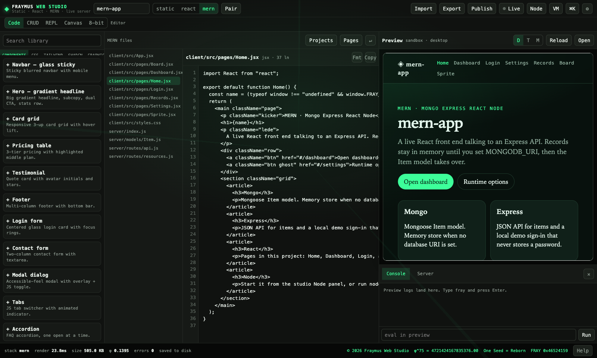

## Code, Pair, and MERN

**Code** is the editor. A static project has HTML, CSS, JS, and an optional WASM pane. React runs the JS pane through Babel in the preview. A MERN project is a file tree: pages in `client/src/pages/`, an Express server, routes, and an Item model. Login asks for an email only and stores a local demo token. It never asks for a password.

The library has more than 110 snippets: components, CSS, Tailwind, Shadcn, graphics, 3D, templates, assets, and MERN starters. Click one to drop it into the active file. **⌘K** opens the command palette. **⌘S** exports. The preview is a sandboxed iframe, the live server, or a Node port, at desktop, tablet, or mobile width. The console runs inside the preview. Type `fray` to print the seed line.

**Pair** puts a second file beside the active one. HTML pairs with CSS, CSS with JS, and a MERN page with `server/routes/api.js`.

  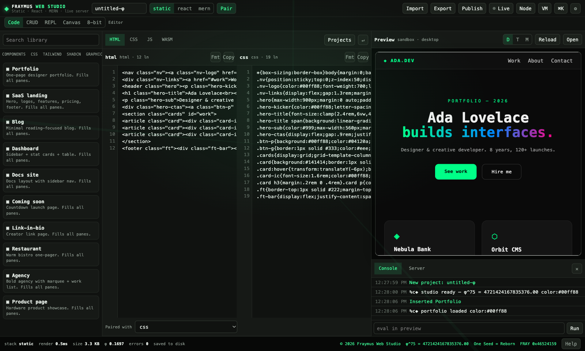

| Stack | Preview | Files |
| --- | --- | --- |
| static | HTML, CSS, JS, optional Tailwind, optional WASM | `html`, `css`, `js`, `wasm` |
| react | Same panes, JSX compiled in the preview | same, with React 18 and Babel |
| mern | Pages concatenated, then `createRoot` | `client/src/pages/*`, `server/index.js`, routes, the Item model |

Mongo is optional. Set `MONGODB_URI` and the Item model uses Mongoose. Without a URI, records stay in memory. The longer tour is [HTML, React, and Pair](../README.md#html-react-and-pair) and [MERN](../README.md#mern).

## HTML and JavaScript

**HTML · JS** is a smaller editor for one page. The left bin holds starters: an image gallery, a font specimen, hand-drawn buttons, a golden-angle canvas, a sketch clock, a sticky todo, and a blank page. HTML and JavaScript sit in two panes. **Stack** piles them. **Side by side** puts them next to each other. The preview updates on a delay, and it can be Fill, Phone, Tablet, or Desktop.

**Run** executes the script. **Copy** and **Export .html** take the page out. **Open in tab** opens it alone. **Place in project** writes it into the open project.

  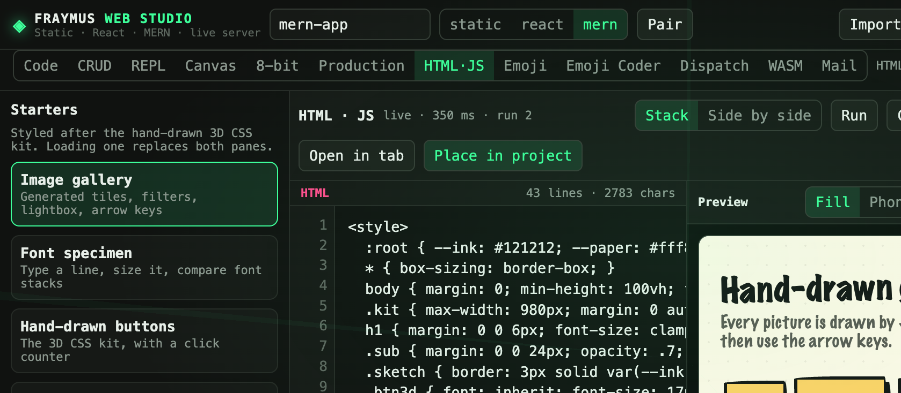

## CRUD

The steps are Schema, Create, Read, Update, Delete, and Compile. A resource name is lowercase. A field is a string up to 500 characters, a number, or a boolean. A resource holds at most 200 records.

| Step | Method | Path |
| --- | --- | --- |
| Read | `GET` collection or one | `/live/<id>/api/r/<resource>` |
| Create | `POST` | same collection path |
| Update | `PUT` | replaces the record |
| Update | `PATCH` | merges the fields you send |
| Delete | `DELETE` | removes by id |

**Package into project** writes the page and the router. On a MERN app that is `client/src/pages/Records.jsx` and `server/routes/resources.js`, mounted at `#/records`. On a static app the markup and the API base are appended to the HTML and JS panes.

  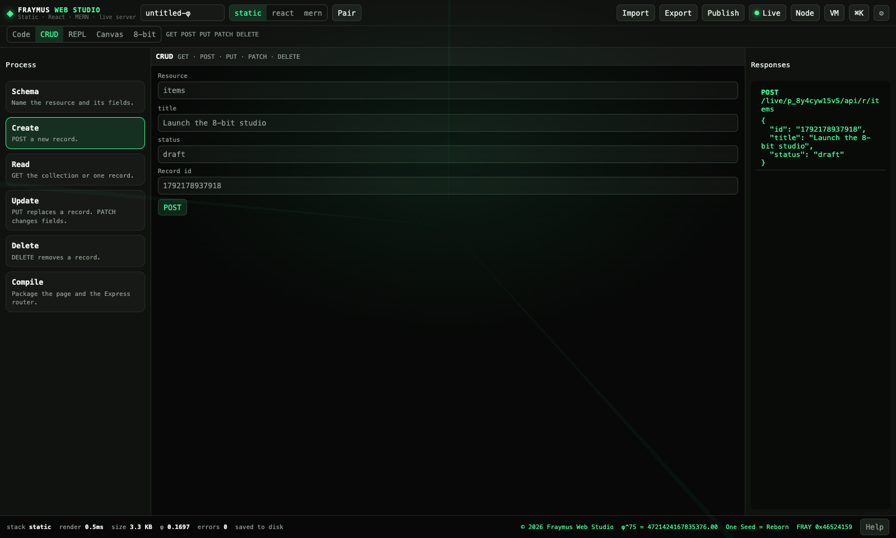

## REPL

Commands run against a DOM stage in the middle. The help list is searchable:

`help` · `clear` · `query` · `queryAll` · `text` · `html` · `style` · `class` · `attr` · `create` · `append` · `remove` · `click` · `focus` · `box` · `tree` · `keys` · `json` · `range` · `sum` · `now` · `typeof`

The bin holds premade methods: fade, accent, insert card, grid, and rename. Drag one onto the strip and press **Run strip**, or click it to run it now. **Design method** saves a method you name. Custom methods stay in this browser. Enter runs the line. The arrow keys walk the history.

  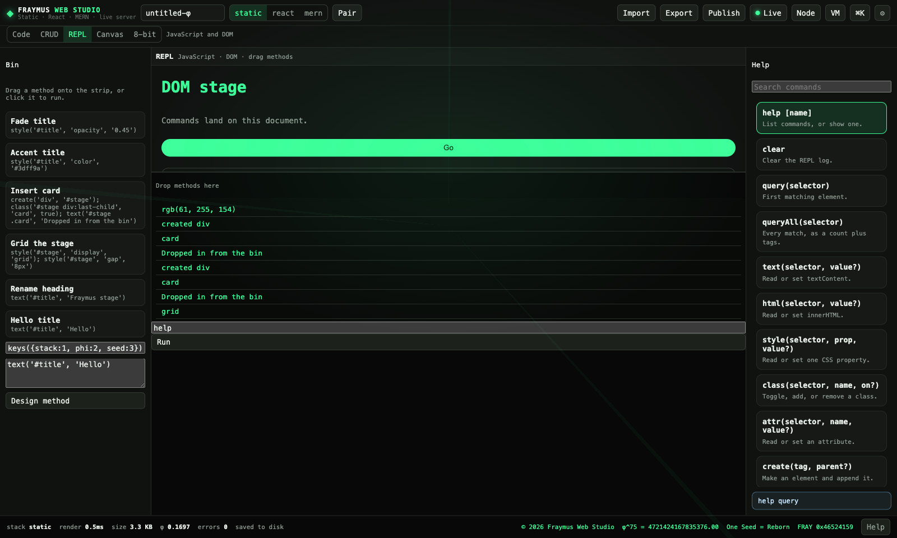

## Canvas

No code on the canvas. The bin holds text, image, link, note, and stack blocks. Drop them on a 2×2, 3×3, or 4×4 cube and switch faces. Stack mode shows the same face top to bottom. Each block is an entity. Its components are content, media, link, style, and layout. Select a block to edit them in the inspector.

**Compile** writes a MERN page at `#/board`, or appends the markup to a static project. The canvas uses an Obsidian palette: near-black ground, muted purple `#7c6af7`. The rest of the studio stays emerald `#3dff9a`.

  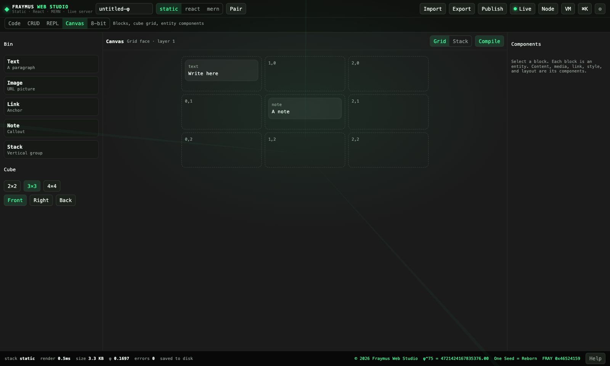

## 8-bit stills

Open **8-bit**. A photo becomes a pixel portrait: hard black outlines, flat cel shading, a black background, and a cyan rim `#00e5ff`. The face stays recognizable. The prompt keeps the person's own skin tone. The studio then matches skin brightness and the **Skin** slider moves it without another render.

<table>
  <tr>
    <td align="center"></td>
    <td align="center">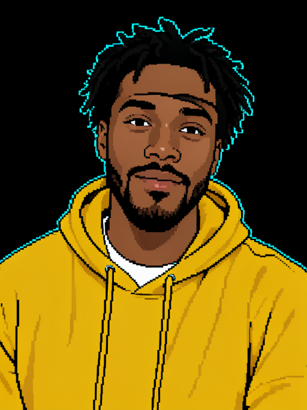</td>
    <td align="center">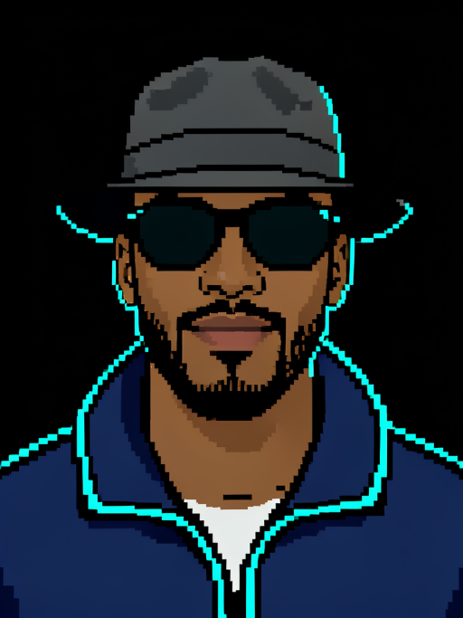</td>
  </tr>
  <tr>
    <td align="center"><b>Photo</b> any image or document</td>
    <td align="center"><b>Real outfit</b> keeps the clothes, hair, and beard</td>
    <td align="center"><b>Avatar</b> fedora, shades, navy jacket, cyan trim</td>
  </tr>
</table>

JPG, PNG, GIF, and WebP open directly. HEIC, TIFF, RAW, PSD, PDF, Word, Pages, and Keynote are converted on the studio server with macOS `sips` and Quick Look. Documents use the first page.

**AI Render** posts the photo to FLUX.2 Klein at `/api/pixel/render`. A still takes about 7 seconds. **Real outfit** keeps the clothes and does not add a hat or sunglasses that are not in the photo. **Avatar** uses the studio costume. **Style reference** adds a second image to copy the look from. **Pixel lock** snaps the render onto a coarser grid.

The other views are built from that render, so they do not call the model again:

<table>
  <tr>
    <td align="center">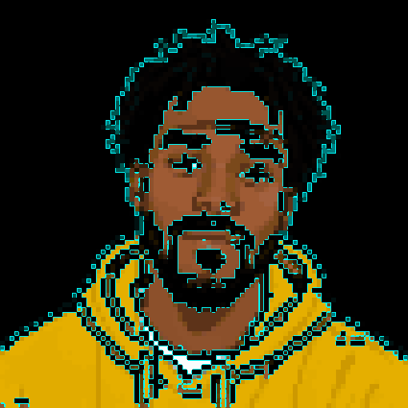</td>
    <td align="center">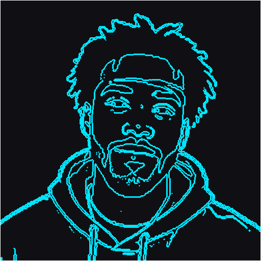</td>
    <td align="center">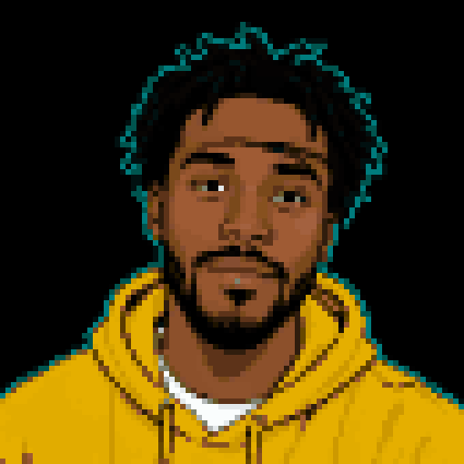</td>
  </tr>
  <tr>
    <td align="center"><b>Character</b> offline filter</td>
    <td align="center"><b>Trace</b> cyan line art</td>
    <td align="center"><b>Abstract</b> flat pixel blocks</td>
  </tr>
</table>

**Edit** works on the render: brush Remove, Keep, and Trace, then Undo, Redo, Expand, Contract, Ceiling, and Sides. **Save** keeps it on the roll. **PNG** downloads it. **Place in project** adds it as a sprite page.

  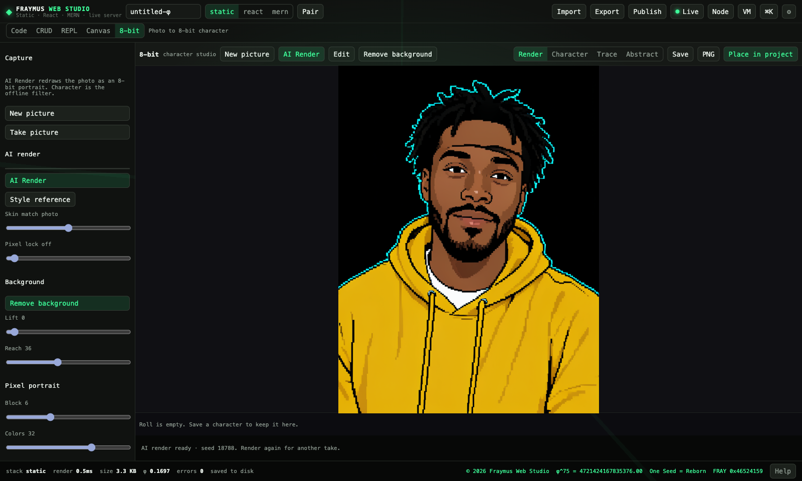

The demo person above is AI-generated. They are not a real person.

Without a token the free Hugging Face queue is used. For a steady queue, put a token in `hf-token.txt` at the repo root, or set `HF_TOKEN`. That file is gitignored. Do not commit it.

The still tour, with the same pictures, stays in the [README](../README.md#8-bit-studio).

## 8-bit camera and video

The model is not in the camera loop and not in playback. A still is about 7 seconds. A camera that waited on that would not be a camera.

| Path | What it uses | What you get |
| --- | --- | --- |
| **Take picture** | Webcam, then the offline Character filter | A live stage. The long edge is 240px so the page can keep a frame rate. **Shutter** stores the full frame. |
| **Style video** | The same filter, 10 frames a second | A pixel video of the whole clip. Fast. A real photo still reads as a grainy photograph. |
| **Cartoon video** | FLUX.2 Klein, 2 frames a second, one locked seed | A flat sprite: hard edges, solid colors, black background, cyan rim. This matches the still AI portrait. |
| **Talk** | Paint on the approved sprite | `closed`, `mid`, `open`, `blink`. Play and WebM do not call the model. |
| **Production** | One model call per face, then the same paint | A cast. Each face keeps its own sprite, mouth, lines, and voice in the project. |

  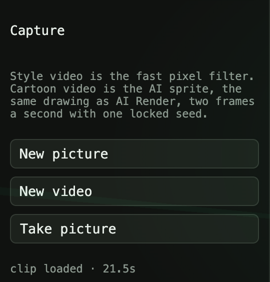
  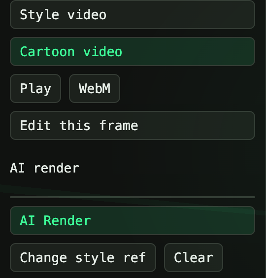

**Take picture** shows the raw camera in a small window and the filtered stage beside it. The sliders are Block, Colors, Reach, Saturation, Outline, and Cyan. **Shutter** copies the full camera frame into the still editor. **Stop** turns the camera off.

**New video**, or a drop of MP4, WebM, or MOV, loads a clip. **Style video** seeks every frame at 10 fps, scales the long edge to 480px, squares the frame on the face, and uses 2-pixel blocks. Frames are kept up to 720px. **Stop** keeps the frames already made. **Play** loops them. **WebM** writes `fraymus-8bit.webm` and stamps the real duration into the file, so a player does not open it as 0:00. **Edit this frame** loads that instant of the original video into the still editor.

**Cartoon video** posts each sampled frame to `/api/pixel/render`. A 21 second clip at 2 fps is 44 model calls. The first seed is reused. Real outfit keeps the clothes. Avatar uses the studio costume. A style reference, if one is set, is the drawing every frame copies. Playback starts only after the frames are stored.

  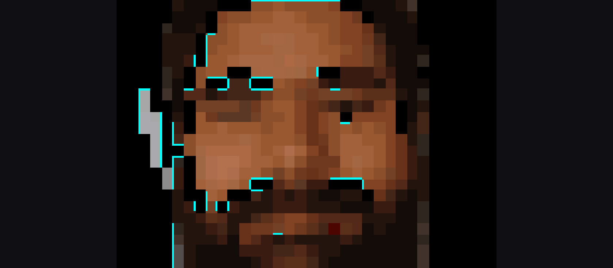

Test frame from <a href="https://commons.wikimedia.org/wiki/File:20140529_-_Smiling.webm">20140529 - Smiling.webm</a> by Clément Bucco-Lechat, <a href="https://creativecommons.org/licenses/by-sa/3.0/">CC BY-SA 3.0</a>. Private photos used to judge this path are not in the repo.

The steps are in [8-bit motion](8BIT_MOTION.md). The current behavior is in [8-bit status](8BIT_STATUS.md).

## Talk

Talk is one approved sprite. **Build mouth buffer** paints four frames on that picture: mouth closed, mouth a little open, mouth open, and a blink. It does not ask the model to redraw the face.

The mouth is the dark slit that has lip color directly above it and directly below it. Only that patch changes. The blink covers the eye whites with the skin from just under each eye, plus a dark lash line. Hair, clothes, and the outline stay put.

Write a **Line**, then attach a WAV, MP3, or M4A with **Voice**. **Up** and **Down** set the order. **Hold** can pin a line to one frame. A vowel or a tone opens the mouth. A hiss stays smaller. Silence closes it, and about every 3 seconds of quiet the blink shows. The words sit on a black bar. **Play** and **WebM** (`fraymus-talk.webm`) read the buffer.

  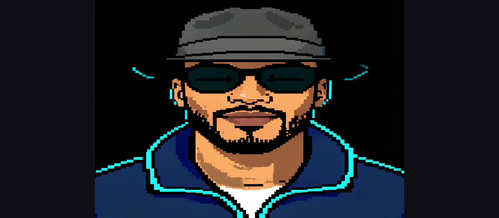

The person above is the AI demo sprite already in this repo. They are not a real person.

## Production

Production is the cast. It is its own workspace, next to 8-bit. The 8-bit tab still edits one picture. Production runs the same steps for as many faces as you add.

1. **Add face** takes a photo.
2. **Make avatar** calls the model once. **Real outfit** keeps the clothes. **Avatar** uses the studio costume.
3. The mouth and the blink are painted on that sprite. Closed, mid, open, and blink stay in the buffer.
4. Each **Line** has words and a voice. The voice belongs to the selected face.
5. **Play** and **WebM** read the buffer. The file is named from the face. They do not call the model.
6. **Keep cast** writes the photo, the sprite, the four frames, the line text, and the WAV into the open project. A refresh brings the cast back. Nothing from the cast is written to `localStorage`.

Selecting another face shows that face's picture and that face's lines. Add the next face and the same steps run again.

A real cast is a person's face, so it is not in this repo. It lives in `data/projects`, which is gitignored. The picture above is the demo sprite, used here so the mouth cell has a face that can be published. Payments and accounts are not built. The reason for the buffer is [Avatar studio](AVATAR_STUDIO.md).

## Emoji

**Emoji** hides bytes and brings them back. Four modes:

| Mode | What it does |
| --- | --- |
| Hide | Text or bytes become one emoji, or one emoji per byte. Reversible, byte for byte. |
| Reveal | A glyph, a DNA string, or zero-width text becomes bytes. |
| DNA | Four bases per byte. A = 00, C = 01, G = 10, T = 11. |
| Zero-width | The same bytes hidden inside a normal sentence. U+200B is 0, U+200D is 1. |

The output can be read as text, hex, Base64, JSON, C, JS, Java, Python, DNA, or a small x86 subset. **Send to Reveal** moves the glyph across. **Place in project** stores it on the open project. A round trip checks that the bytes come back.

  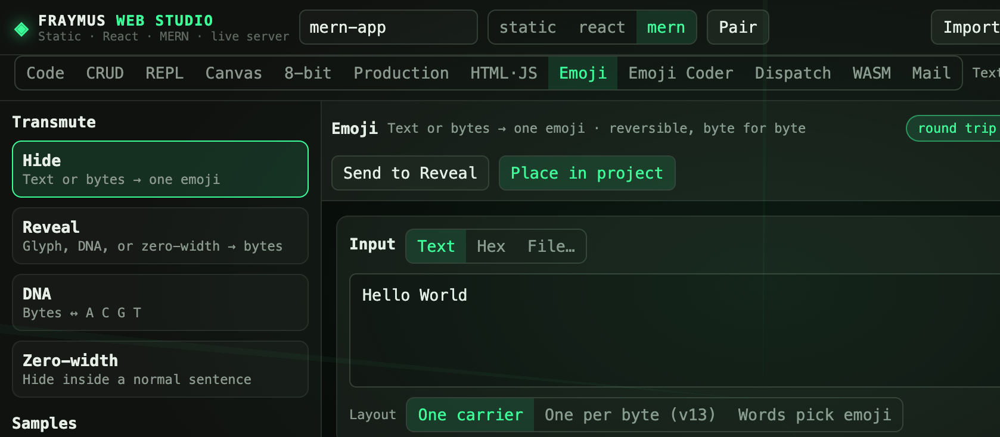

The longer notes on the codecs are in [Emoji transmutation](EMOJI_TRANSMUTATION_OUTLINE.md). The phrase inside the private read-back files stays private.

## Emoji Coder

**Emoji Coder** turns emoji markup into a live page. An element glyph opens a tag. Style glyphs after it add CSS. `{text}` fills the tag, `>` nests, `+` places one beside the next, `*3` repeats, and `( )` groups. `.name` and `#id` add a class or id.

The palette is the bin: elements, styles, and actions. **My keys** are macros. A combination expands to more emoji. An element key adds a real tag. A CSS key holds full declarations. **Live preview** shows the page. The other panes show HTML, CSS, JS, and Java. **Place in project** writes the page into the open project.

  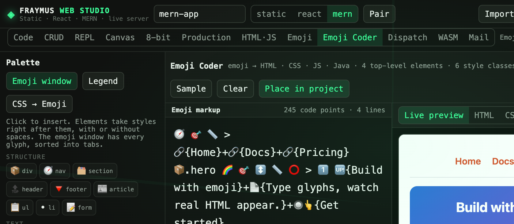

## Dispatch

A deploy message is a program hidden in emoji. The recipient inside it is a FRAYMUS number, `fx-` plus four groups of four hex digits. The mailbox for this studio is `fx-4041-f10e-7ee2-2bdc`. An email address is not that number. Dispatch will not sign one, and the hub will not accept one.

**Compose** builds the envelope: from, to, subject, and a program (CSS, JS, HTML, or WASM). **Sign (Ed25519) & encode** writes a real signature and turns the bytes into the 64-emoji alphabet. `💤` is the padding character. **Run heartbeat** then does the six ticks: decode, verify the signature, Merkle and the time window, unpack the files, run the program in a sandbox, and hand it to mail.

  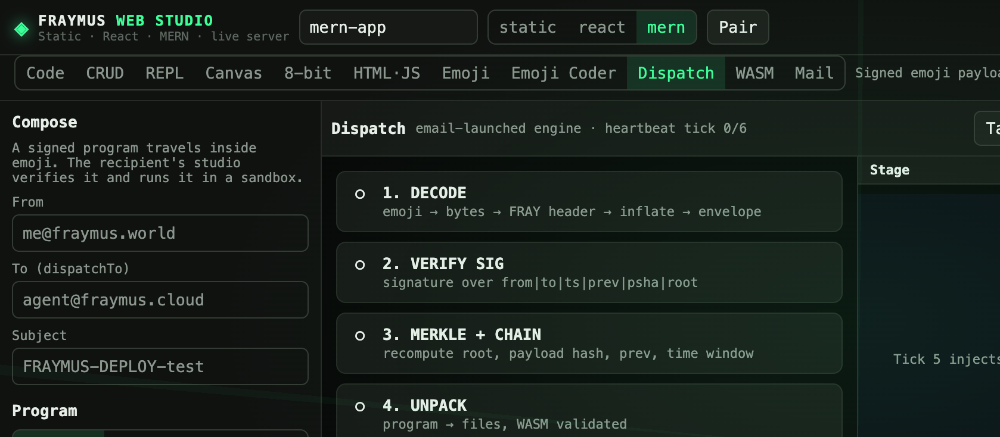

The watcher is separate from the tab. `scripts/email-watcher/watcher.mjs` polls Gmail for subjects that start with `FRAYMUS-DEPLOY-`. A verified payload goes to the local hub on `127.0.0.1:8787`.

| Condition | POST |
| --- | --- |
| Canon contains `COMMAND:EMAIL` | `/api/mail/forward` |
| `dispatchTo` is `FRAYNIX` | `/api/fraynix/feel` |
| A FRAYMUS number, or `BROADCAST` | `/api/dispatch` |

Fraymus Academy is a separate app. This studio only uses the same number rule. The pass that reached the hub is written up in [Email that runs](../README.md#email-that-runs).

## WASM

**WASM** compiles a small stack program into a real WebAssembly module, then into one emoji.

The assembly is FrayVM: `PUSH`, `DUP`, `POP`, `PRINT`, `DEC`, `JZ`, `JUMP`, `DROP`, `HALT`, and labels. **Compile** builds the bytecode. **Forge** seals it. **Run** executes it. **Build** emits the module. **Probe** reads a module back. **Nodes** weaves the palette into a document. **Merkle** and **Golden** are the hash and the seed checks. **Place in project** stores the module on the open project.

The demo module in the Code workspace is the bytes whose magic is `00 61 73 6d` and whose `main()` returns 15.

  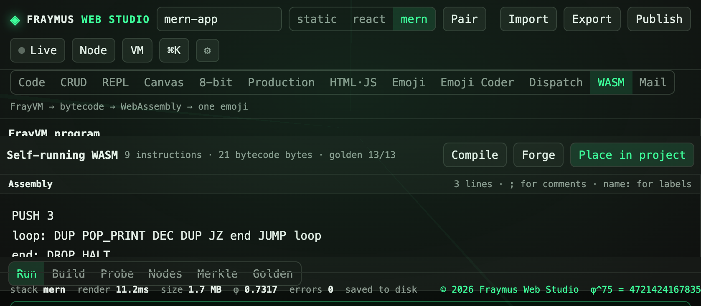

## Mail

**Mail** reads and sends. Gmail uses IMAP and SMTP once an app password is saved on this machine, in `~/.fraymus-v13/email-watcher.env`. That password is not in the repo. Local mail is `data/mailbox/box.json`.

Folders, compose, reply, reply all, forward, flag, move, trash, and import or export as `.eml` or `.mbox` are all there. The watcher can deliver a deploy message without this tab being open.

  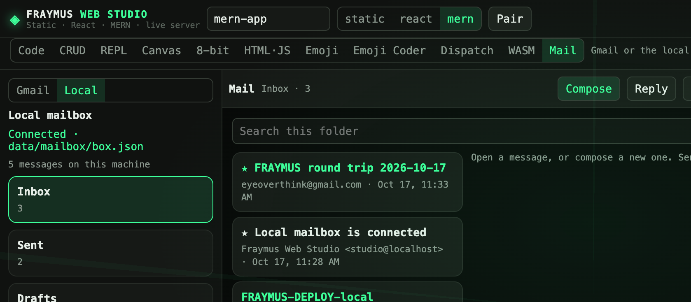

## Live, Node, VM, publish, export

| Action | Result |
| --- | --- |
| Live | Serves the preview at `/live/<id>/` from the studio process, with the demo API |
| Node | Starts the project with `NODE_PATH` pointed at the studio `node_modules` |
| VM | Browser sandbox, live, Node, or Docker. Docker is used only when `docker` is installed |
| Publish | Writes `data/published/<slug>/` and opens `/published/<slug>/` |
| Export | Single-file HTML, project JSON, static zip, full project zip, or a deploy bundle |

The deploy bundle includes `vercel.json`, `netlify.toml`, a Dockerfile, Compose, `nginx.conf`, and `DEPLOY.txt`. Static exports load React and Babel from unpkg. MERN still needs Node for the API.

  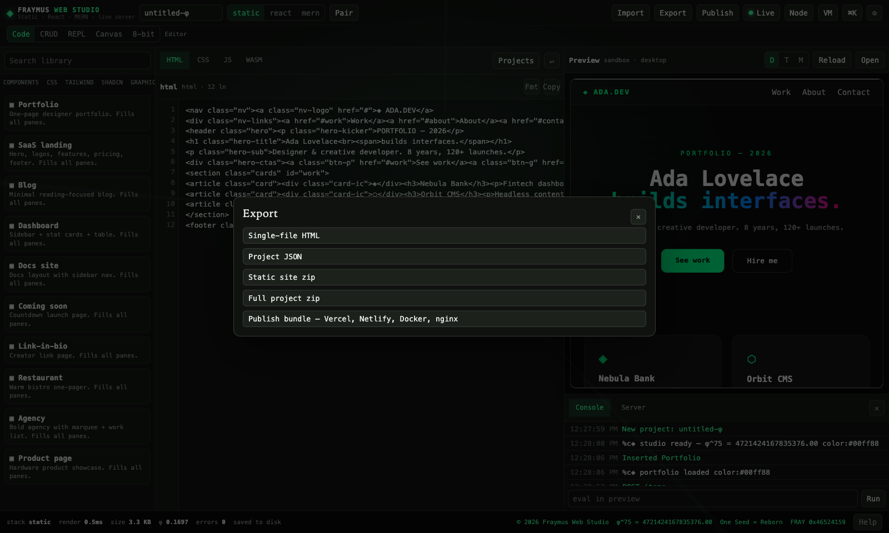

The route table is in the [README reference](../README.md#studio-api). These are the paths that matter for the additions:

| Method | Path | Role |
| --- | --- | --- |
| POST | `/api/pixel/render` | AI 8-bit still. Body: `image`, optional `style`, `mode` (`real` or `avatar`), optional `seed` |
| POST | `/api/pixel/convert` | Any image or document in, PNG out. File name in `X-File-Name` |
| PUT | `/api/projects/:id` | Saves the project, including a Production cast |
| GET | `/api/health` | Process up, Mongo state |

## What stays off this page

| Thing | Where it lives |
| --- | --- |
| A face, a sprite of that face, a voice | `data/projects`, gitignored |
| Hugging Face token | `hf-token.txt` or `HF_TOKEN`, gitignored |
| Gmail app password | `~/.fraymus-v13/email-watcher.env` |
| Local mailbox | `data/mailbox`, gitignored |
| Fraymus Academy | Its own app. Not this repo |

## Files added for the video and the cast

| File | Role |
| --- | --- |
| `client/src/tools/PixelPage.jsx` | Stills, camera, Style video, Cartoon video, Talk |
| `client/src/tools/pixelEngine.js` | Mask, face band, crop, the offline filter |
| `client/src/tools/pixelMotion.js` | Frame grab, 10 fps filter, 2 fps cartoon input, WebM duration |
| `client/src/tools/pixelTalk.js` | Which mouth a voice sample picks, and the line order |
| `client/src/tools/pixelMouth.js` | Paints the mouth and the blink on one sprite |
| `client/src/tools/StudioPage.jsx` | Production: the cast |
| `server/index.js` | `/api/pixel/render` and `/api/pixel/convert` |
| `docs/showcase/` | The pictures on this page and on the README |

## Brand

| Mark | Meaning |
| --- | --- |
| ◈ | Studio mark |
| φ^75 = 4721424167835376.00 | Seed constant. Type `fray` in the preview console |
| One Seed = Reborn | Brand line paired with the seed |
| FRAY `0x46524159` | The four ASCII bytes of FRAY |
| Emerald `#3dff9a` | Studio accent |
| Cyan `#00e5ff` | 8-bit rim light and trace color |

© 2026 Fraymus Web Studio. The footer on the studio, and on pages the studio generates, keeps the mark, the seed, the line, and the hex.

---

  <a href="../README.md#copyright">© 2026 Fraymus Web Studio</a> · <a href="../README.md#brand">◈</a> · <a href="../README.md#brand">φ^75 = 4721424167835376.00</a> — <a href="../README.md#brand">One Seed = Reborn</a> · <a href="../README.md#brand">FRAY 0x46524159</a>

