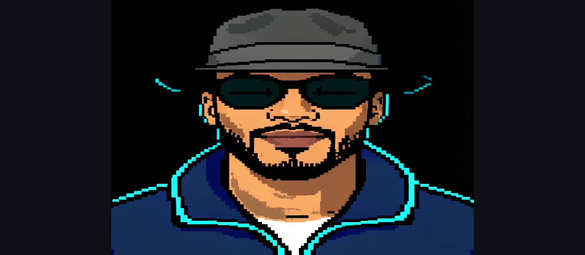

# Chapter — Avatar studio

The first slice is in the 8-bit tab: one approved sprite, four mouth frames, a voice that picks the frame. The timeline, captions, and payments in the rest of this chapter are not built. The workspace it builds on is described in [8-bit status](8BIT_STATUS.md) and [8-bit motion](8BIT_MOTION.md). The short tour stays in the [README](../README.md#8-bit-studio).

The aim is an animated avatar that someone else can order: one face in, a cartoon sprite that talks, many videos out, without sending every frame back through the model.

## Why one picture

Cartoon video already proved the drawing. It also showed the limit. A 21 second clip at 2 frames a second is 44 model calls. Each call redraws the face, so the jacket, the glasses, and the mouth can drift even when the seed is locked. Playback is only smooth after those frames are stored.

The model is a renderer. It should fill a buffer. It should not sit in the play path.

Taking one approved picture and animating that picture is the shorter path, and it is the one that can be sold. A voice track on top of it is the first animation.

## The frame buffer

The buffer is the avatar's RAM. A small set of finished frames sits in the project. Play, scrub, and export only read it.

1. A face photo goes in once.
2. **AI Render** makes the master sprite. That is the flat cartoon already in the app: hard edges, solid colors, black background, cyan rim. The person approves this still before anything is animated.
3. The model sees that sprite again, not the original video. It draws a small set from it: mouth closed, mouth a little open, mouth open, a blink, a slight turn. About 8 to 12 frames. Those frames are the buffer.
4. The buffer stays in the project. Nothing calls Hugging Face while the video runs, so the rate stays steady.
5. A voice track picks the cell. Louder, or an open-mouth moment, shows the open mouth. Quiet shows the closed mouth. The picture is not invented again.

A live pipeline that restyles the camera, or that posts every video frame, is the wrong machine for this. The expensive work happens once, into the buffer. After that the buffer is what plays.

## The studio, not a full editor

The content studio is that buffer plus a timeline. It is specific to this 8-bit avatar. It is not a copy of a general video editor.

What it needs, because that is how a timeline editor is actually used:

| Piece | Job |
| --- | --- |
| Bin | The master sprite and the buffer cells |
| Preview | Reads the buffer only. No model call. |
| Picture track | Which cell to show, and how long to hold it |
| Voice track | The recording or the generated voice. It chooses the mouth cell. |
| Caption track | The line being said, so a video can be posted |

Cuts and holds live on the timeline. Effects do not. The 8-bit look is already in the frames.

What it does not need in the first slice: a general effects stack, color wheels, a multicam bin, or a second model pass on export.

## What a customer pays for

The product unit is a filled buffer, then as many timelines as they want from it.

- Creating the avatar spends the model calls: one master sprite, then the mouth and pose cells. That is the paid render.
- Making a video spends the timeline: drop a voice, the mouth follows, export a WebM. Playback and export do not spend another model call.
- A second script is another timeline on the same buffer, not another face render.

The studio stays on `127.0.0.1` until that order flow exists. This chapter does not add accounts or payments. It names the thing those would sell.

## First slice

This is in the app, under **Talk** on the 8-bit tab. The steps are in [8-bit motion](8BIT_MOTION.md).

1. **AI Render** approves the sprite.
2. **Build mouth buffer** draws four frames from that sprite only: `closed`, `mid`, `open`, `blink`. Same seed. The sprite is the style reference.
3. The cells stay in memory for the session. They are not written to `localStorage`.
4. Each **Line** has words and a voice. A vowel or a tone opens the mouth. A hiss stays smaller. Silence closes it. The lines play in order, with the words on a black bar.
5. **Play** and **WebM** read the buffer. They do not call the model. The WebM is `fraymus-talk.webm` and includes every line.

  

The person above is the AI demo sprite already in this repo. They are not a real person.

Phonemes can replace loudness later without changing the buffer. A timeline of several voice clips is still the later chapter.

## Continuity

| Chapter | What it covers |
| --- | --- |
| [README](../README.md#8-bit-studio) | The tour of the studio as it stands |
| [8-bit status](8BIT_STATUS.md) | What works today, including Cartoon video |
| [8-bit motion](8BIT_MOTION.md) | The controls, in order |
| This chapter | Mouth buffer is in the app. Timeline and payments are not |
