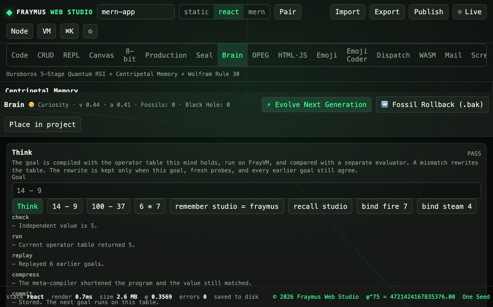
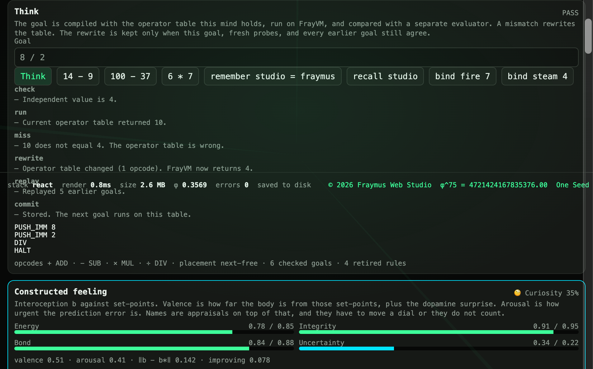

# Brain

One long tool. **Think** compiles a goal with the operator table this mind holds, runs it on FrayVM, and compares it with a separate evaluator. A mismatch rewrites the table. The rewrite is kept only when this goal, fresh probes, and every earlier goal still agree.

Module: [`client/src/tools/BrainPage.jsx`](../../client/src/tools/BrainPage.jsx), loop in [`client/src/tools/brainMind.js`](../../client/src/tools/brainMind.js), machine in [`client/src/tools/frayvm.js`](../../client/src/tools/frayvm.js).

The φ-scaled weight kernel that measures ternary codes against a GGUF file is not this tab. It lives in [eyeoverthink/fraymus-brain](https://github.com/eyeoverthink/fraymus-brain).

  

## How to run

Open **Brain**. The Think card is the first card under the memory bar. The goal box starts at `14 - 9`. Press **Think**.

Suggested order:

1. `14 - 9`
2. `100 - 37`
3. `6 * 7`
4. `remember studio = fraymus` then `recall studio`
5. `bind fire 7` then `bind steam 4`

`recall nowhere` is a **FAIL**. A missing fact is not a pass. A normal sentence is **UNVERIFIED**.

## What this run showed

Goal `14 - 9`. Verdict **PASS**.

| Step | Line |
| --- | --- |
| check | Independent value is 5. |
| run | Current operator table returned 5. |
| replay | Replayed 6 earlier goals. |
| compress | The meta-compiler shortened the program and the value still matched. |
| commit | Stored. The next goal runs on this table. |

Program after compress: `PUSH_IMM 5` then `HALT`.

Status on the card: opcodes include `+ ADD`, `− SUB`, `× MUL`, `÷ DIV`, placement `next-free`, **7 checked goals**, **4 retired rules**.

The header read `Curiosity · v 0.44 · a 0.41 · Fossils: 0 · Black Hole: 0`. The feeling card under Think showed Curiosity at 37%.

The seed table maps `-`, `*`, and `/` to `ADD`, so the first real difference, product, or quotient on a fresh mind is a miss. This run already had a learned table, which is why `14 - 9` passed at 5 and replayed six earlier goals. An earlier figure of the miss on `8 / 2` (table returned 10, independent value 4, opcode rewritten to `DIV`) is in the showcase:

  

## Other lobes

| Lobe | Button | What runs |
| --- | --- | --- |
| Memory | Store / Pull, Rule 30 Drift Tick | Golden-angle orbits. Radius 21 is the horizon. |
| Evolution | Evolve Next Generation | Four kernels. Five physics checks at `1e-12`. Fossil rollback restores the previous genome. |
| Feeling | Witness, Appraise, Ground OPEG | Interoception against set-points. The Ground OPEG button is the small WASM bridge in `emotionCore.js`, not the OPEG tab. |
| Audit | Run 4-proof audit | A 16-state toy. Theater, feedforward, and split substrates are denied. |
| Cortex | Think & Persist | Needle reflex always. Ollama at `127.0.0.1:11434` when a model is selected. |
| Co-pilot | Mint seal, Mutate project, Compile WASM | Writes into the open project when the risk dial allows it. |
| Ternary / NCM | Pulse | 16×16 weights in `{-1, 0, +1}`. |
| Nexus | Recursive Dialectical Turn | Offline skills in [`sovereignEcosystem.js`](../../client/src/tools/sovereignEcosystem.js). |
| FlyGNN | Measure → Train | 1,000 neuron objects, thirteen slices of seventy. |
| Continuum | Run Sovereign AGI Continuum | Seven suite functions, then an epoch score that follows `verified`. |

Continuity is `POST /api/brain/memory`. The file is `data/brain/continuity.json`, gitignored.

Manuals: [Sovereign Brain](../SOVEREIGN_BRAIN_README.md), [ecosystem](../SOVEREIGN_AGENT_ECOSYSTEM_OUTLINE.md), [FlyGNN](../FLYGNN_NODULAR_SUPERPOWERS_OUTLINE.md), [continuum plan](../SOVEREIGN_AGI_CONTINUUM_PLAN.md), [ISA](../ISA_SPECIFICATION.md).

## Expect

- **PASS** only when the table and the independent evaluator agree, and every stored goal still agrees.
- **FAIL** on a missing fact.
- **UNVERIFIED** on a sentence with nothing to check.
- Think does not call Ollama. Think & Persist does.

[All tabs](README.md)
