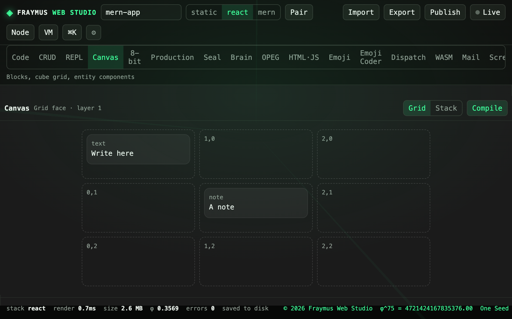

# Canvas

Blocks on a cube. Front, Right, Back, and Stack. The accent is purple `#7c6af7`, the canvas color, not the studio emerald.

Module: [`client/src/tools/CanvasPage.jsx`](../../client/src/tools/CanvasPage.jsx).

  

## How to run

Open **Canvas**. Pick a grid of 2×2, 3×3, or 4×4. Type into a cell. **Compile** writes `client/src/pages/Board.jsx` into the open project.

## What this run showed

A **3×3** grid. One cell read `Write here` at the text block. Another read `A note` at the note block. **Grid**, **Stack**, and **Compile** were on the bar.

## Expect

- Empty cells stay empty. They are not filled with sample copy.
- Stack shows the same blocks as a pile instead of a grid.
- Compile is a project write. The cube itself does not call the API.

[All tabs](README.md)
