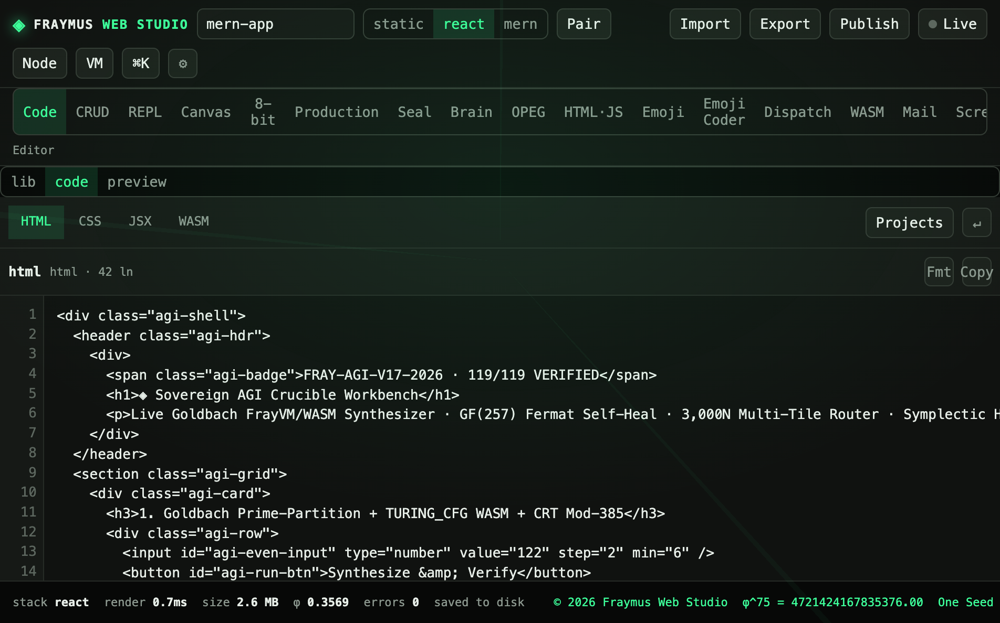
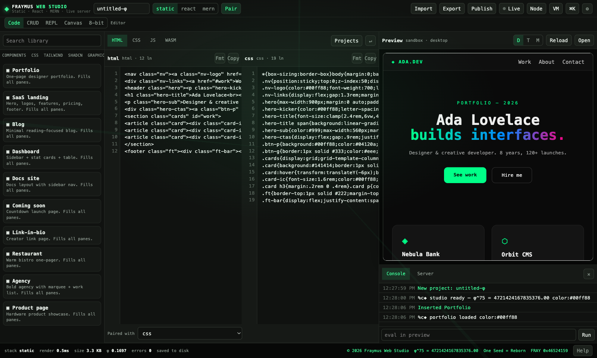

# Code

The Code tab is the studio shell: a project library, a Pair editor, and a live preview. Static, React, and MERN are the three stacks. Import, Export, and Publish sit on the top bar.

Module: [`client/src/App.jsx`](../../client/src/App.jsx), project model in [`client/src/model.js`](../../client/src/model.js).

<p align="center">
  
</p>

## How to run

```bash
npm install
npm run dev
```

Open the Vite URL (default [http://127.0.0.1:5173](http://127.0.0.1:5173)). **Code** is the first tab.

| Control | What it does |
| --- | --- |
| Project name | Renames the open project. This run was `mern-app`. |
| `static` / `react` / `mern` | Switches the stack. This run was **react**. |
| Pair | Edits the document and the stylesheet together. |
| Import | Reads a local file into the project. |
| Export | One HTML file, project JSON, a static zip, a full zip, or a deploy bundle. |
| Publish | Writes `data/published/<slug>/` and serves `/published/<slug>/`. |
| Live | Preview at `/live/<id>/`. The dot was on in this shot. |
| Node / VM / %K | Start a Node process, pick the sandbox, or open the command palette. |

Type `fray` in the preview console. It prints the seed `4721424167835376`.

## What this run showed

The editor was open on the project HTML, **42 lines**. The stack buttons showed **react** selected. The status line read `react`, render about `0.7ms`, size `2.6 MB`, φ `0.3569`, `errors 0`, `saved to disk`.

Pair, from an earlier figure of the same editor:

<p align="center">
  
</p>

## Wiring

A change enters the project through a pure apply function in `model.js`. The preview iframe loads the composed document. Vite proxies `/api`, `/live`, `/published`, and `/vendor` to `127.0.0.1:4177`.

`data/projects/` is gitignored. A published slug is local too.

## Expect

- Switching stacks does not drop the open file name.
- Pair shows both panes.
- Export downloads a zip without calling a remote host.
- The footer stays `© 2026 Fraymus Web Studio · φ^75 = 4721424167835376.00 · One Seed = Reborn · FRAY 0x46524159`.

[All tabs](README.md)
