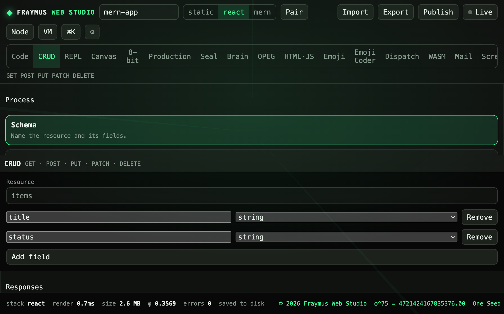

# CRUD

Six steps that turn a schema into live REST routes and, on Compile, into MERN source inside the open project.

Module: [`client/src/tools/CrudPage.jsx`](../../client/src/tools/CrudPage.jsx).

  

## How to run

1. `npm run dev`
2. Open **CRUD**.
3. Walk Schema → Create → Read → Update → Delete → Compile.

Live routes are `/live/:id/api/r/:resource` on the studio API.

## What this run showed

The **Schema** step was open. Resource name `items`. Two fields:

| Field | Type |
| --- | --- |
| `title` | string |
| `status` | string |

Compile, on a MERN project, writes `client/src/pages/Records.jsx` and `server/routes/resources.js` through the project apply path. A static or React project still previews the collection against the live demo API.

## Expect

- Adding a field shows it on the next step.
- Create posts a row. Read lists it. Update changes it. Delete removes it.
- Compile does not invent a database. Mongo stays off until `MONGODB_URI` is set.

[All tabs](README.md)
