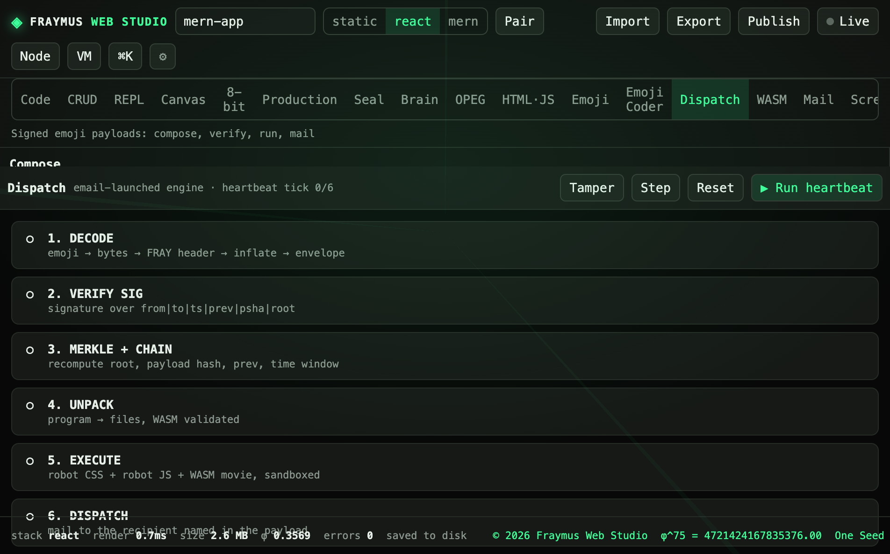

# Dispatch

A signed program travels inside emoji. Compose, verify, run, and hand off to Mail. The pipeline is six steps. The heartbeat ticks them in order.

Module: [`client/src/tools/DispatchPage.jsx`](../../client/src/tools/DispatchPage.jsx). The optional hub is [`scripts/email-watcher/hub.mjs`](../../scripts/email-watcher/hub.mjs) on `127.0.0.1:8787`.

  

## How to run

Open **Dispatch**. Fill From, To, Subject, and the program parts (Robot CSS, Robot JS, HTML, WASM). **Sign (Ed25519) & encode** builds the carrier. **Run heartbeat** walks the six steps. **Step** advances one. **Tamper** breaks the payload so a later check fails. **Reset** restores the archive robot.

To is a FRAYMUS number, `fx-xxxx-xxxx-xxxx-xxxx`. The mailbox id for this machine is shown on the compose column. It is local state, not a secret in git.

A subject that starts with `FRAYMUS-DEPLOY-` is the watcher’s cue when the hub is running.

## Pipeline

| Step | Work |
| --- | --- |
| 1. DECODE | emoji → bytes → FRAY header → inflate → envelope |
| 2. VERIFY SIG | signature over `from\|to\|ts\|prev\|psha\|root` |
| 3. MERKLE + CHAIN | recompute root, payload hash, prev, time window |
| 4. UNPACK | program → files, WASM validated |
| 5. EXECUTE | robot CSS + robot JS + WASM movie, sandboxed |
| 6. DISPATCH | mail to the recipient named in the payload |

Carrier choices: Emoji-64 (each base64 character is one glyph from a 64-symbol alphabet; padding is a sleep glyph) or one glyph. Deflate is optional before encoding.

## What this run showed

The pipeline was idle at **heartbeat tick 0/6**. All six rows were open circles, with the descriptions above. The session key is minted in the tab and replaced on reload. It is not written into this manual and it is not the Hugging Face token.

## Expect

- Sign produces a carrier you can copy.
- Tamper fails VERIFY SIG or MERKLE. Execute does not run a failed envelope.
- Mail handoff uses the local mailbox. Gmail credentials stay in `data/mailbox/` or `~/.fraymus-v13/email-watcher.env`, both outside git.

[All tabs](README.md)
