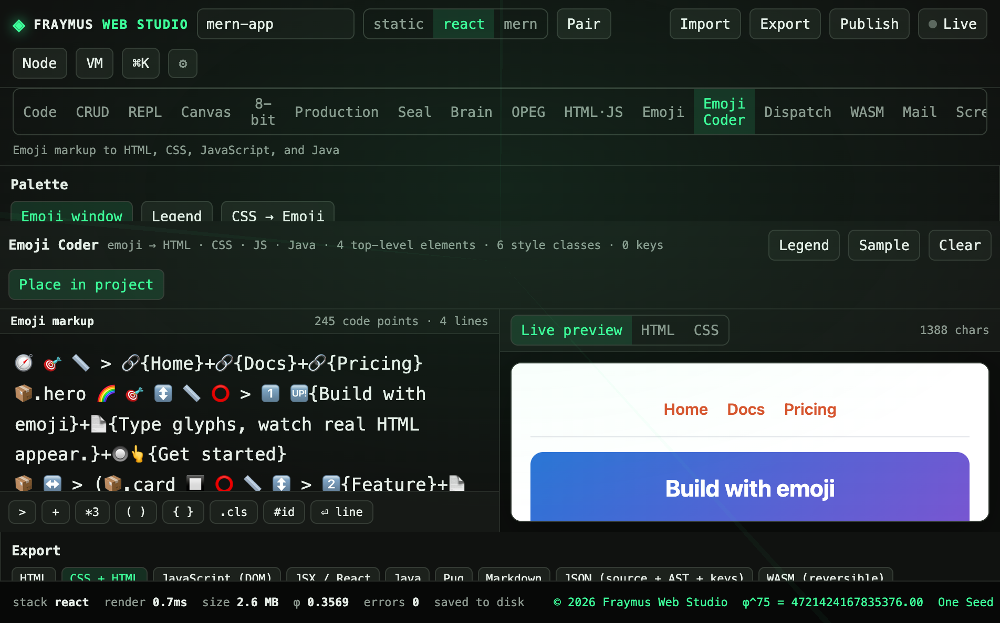

# Emoji Coder

Emoji markup compiles to HTML, CSS, JavaScript, and Java. Elements take styles on the glyphs that follow them. The emoji window lists every glyph by tab.

Module: [`client/src/tools/EmojiCoderPage.jsx`](../../client/src/tools/EmojiCoderPage.jsx).

  

## How to run

Open **Emoji Coder**. The sample is already in the markup box. **Sample** restores it. **Clear** empties it. **Legend** lists the keys. **Place in project** writes the chosen export into the open project.

Export targets on the bar: HTML, CSS + HTML, JavaScript (DOM), JSX / React, Java, Pug, Markdown, JSON (source + AST + keys), WASM (reversible).

## What this run showed

| Meter | Value |
| --- | --- |
| Markup | 245 code points · 4 lines |
| Structure | 4 top-level elements · 6 style classes · 0 keys |
| Preview HTML | 1388 chars |

The live preview showed a nav of **Home**, **Docs**, **Pricing** and a button reading **Build with emoji**. The markup uses the nav, heading, button, and card keys from the palette.

Palette groups: structure, text, interactive, color, background, layout, type. A custom key can bind a combination to an element.

## Expect

- Editing a glyph updates the preview without a separate compile button.
- CSS → Emoji is the reverse direction of the palette.
- WASM export is reversible with the codec. It is not the FrayVM compiler on the WASM tab.

[All tabs](README.md)
