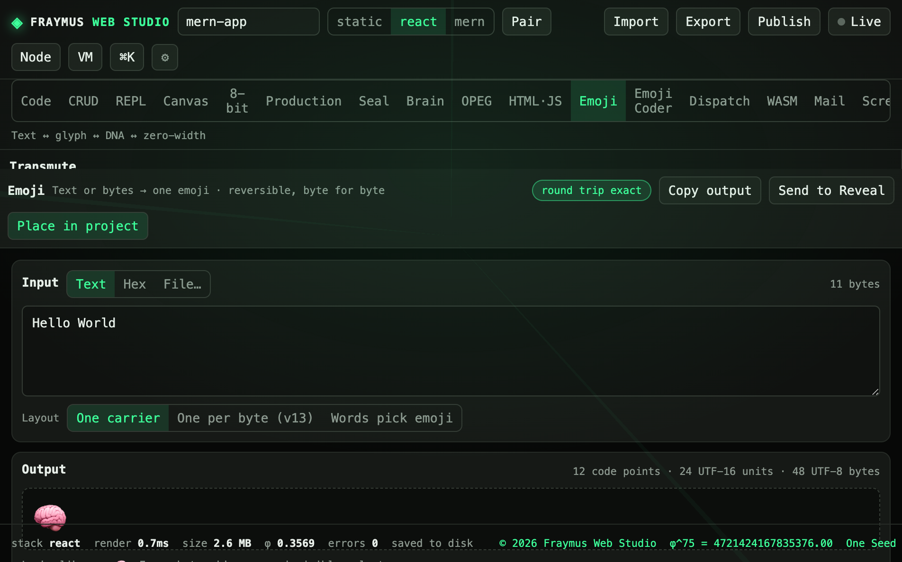

# Emoji

Text or bytes become one emoji, and the emoji becomes the same bytes again. Variation selectors, DNA letters, and zero-width characters are the three layouts.

Module: [`client/src/tools/EmojiPage.jsx`](../../client/src/tools/EmojiPage.jsx).

  

## How to run

Open **Emoji**. Type in the input, or switch to Hex or File. Pick a layout:

| Layout | What it does |
| --- | --- |
| One carrier | The whole payload rides in one glyph |
| One per byte (v13) | One visible emoji per byte |
| Words pick emoji | A word list chooses the carrier |

**Copy output** copies the glyph. **Send to Reveal** hands it to the decoder on the same page. **Place in project** stores the result on the open project.

The codec hides up to 64 KB.

## What this run showed

Input `Hello World`, **11 bytes**, layout **One carrier**. The badge read **round trip exact**.

| Meter | Value |
| --- | --- |
| Code points | 12 |
| UTF-16 units | 24 |
| UTF-8 bytes | 48 |

The output glyph was a single carrier (the brain emoji on this run).

## Expect

- Round trip exact means decode(encode(bytes)) equals the input bytes.
- A file larger than the cap is refused rather than truncated silently.
- The glyph is text. It is not an image attachment.

[All tabs](README.md)
