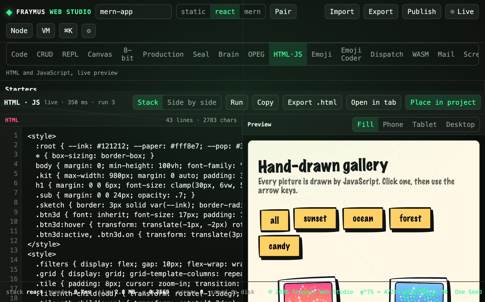

# HTML·JS

HTML and JavaScript side by side, with a live preview. Starters fill the editor. Run evaluates the page in the preview pane.

Module: [`client/src/tools/WebJsPage.jsx`](../../client/src/tools/WebJsPage.jsx).

  

## How to run

Open **HTML·JS**. Pick a starter or type into the HTML and JS panes. **Stack** puts the panes in a column. **Side by side** splits them. **Run** refreshes the preview. **Copy**, **Export .html**, and **Open in tab** take the document out. **Place in project** writes it into the open project.

Preview widths: Fill, Phone, Tablet, Desktop.

## What this run showed

The hand-drawn gallery starter was on screen.

| Meter | Value |
| --- | --- |
| Mode | Stack |
| Live | 350 ms |
| Runs | 3 |
| HTML | 43 lines · 2783 chars |

The preview title was **Hand-drawn gallery**. The lede: every picture is drawn by JavaScript. Buttons on the drawing: `all`, `sunset`, `ocean`, `forest`, `candy`.

## Expect

- Run increments the run count and updates the live millisecond.
- Export .html is a file, not a publish.
- Place in project changes the open document. It does not start a server.

[All tabs](README.md)
