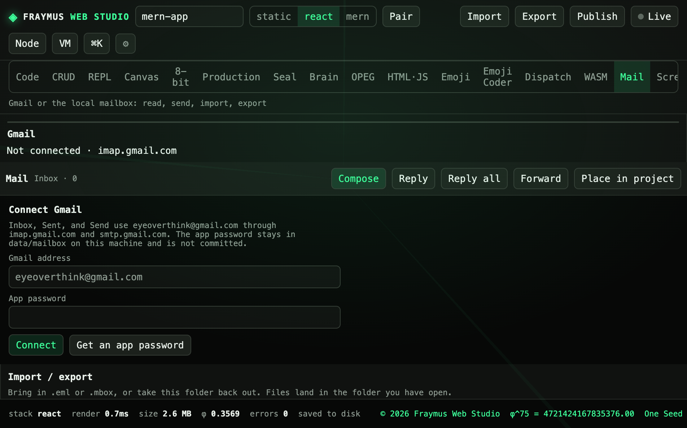

# Mail

A local mailbox plus an optional Gmail connection. Read, compose, reply, forward, import `.eml` or `.mbox`, and export the open folder.

Module: [`client/src/tools/MailPage.jsx`](../../client/src/tools/MailPage.jsx).

  

## How to run

Open **Mail**. The **Gmail** pane connects with an app password. The **Local** pane is the mailbox on this machine.

| Action | Where it goes |
| --- | --- |
| Connect | IMAP `imap.gmail.com`, SMTP `smtp.gmail.com` |
| Inbox, Sent, Send | The connected account, or the local box |
| Import file / paste | The folder you have open |
| Export .eml / Export folder .mbox | A download |

The app password stays in `data/mailbox/` on this machine. That directory is gitignored. Watcher credentials, if you run the hub, belong in `~/.fraymus-v13/email-watcher.env` as `IMAP_USER` and `IMAP_PASS`. Do not commit either file.

## What this run showed

**Not connected.** Inbox **0**. The app-password field was empty. Compose, Reply, Reply all, Forward, and Place in project were on the bar. No message was sent for this manual.

Folders listed on the pane: Inbox, Sent, Drafts, Archive, Junk, Trash, each at 0 while disconnected.

## Expect

- Connect fails closed without an app password.
- A password typed here is not written into the repository.
- Place in project copies a message into the open project as text. It does not upload it.

[All tabs](README.md)
