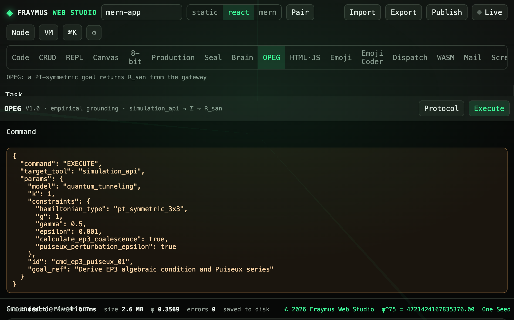

# OPEG

A PT-symmetric goal goes through the studio gateway and comes back as `R_san`. The raw pipe can carry metadata. The receipt you keep does not.

Modules: [`client/src/tools/opeg.js`](../../client/src/tools/opeg.js), [`client/src/tools/OpegPage.jsx`](../../client/src/tools/OpegPage.jsx). Law files: [`config/system_protocol.yaml`](../../config/system_protocol.yaml), [`modelfiles/fraynix_core.yaml`](../../modelfiles/fraynix_core.yaml). Routes in [`server/index.js`](../../server/index.js). Tests in [`server/opeg.test.mjs`](../../server/opeg.test.mjs).

This is not the Ground OPEG button on the Brain feeling card. That button is a small WASM bridge in `emotionCore.js` (`ep3(16) = 4`). This tab computes the 3×3 Hamiltonian.

<p align="center">
  
</p>

## How to run

Open **OPEG**. The defaults are the demo task. Press **Execute** in the title bar. **Protocol** loads both YAML files from the API.

```bash
curl -s http://127.0.0.1:4177/api/opeg/execute \
  -H 'content-type: application/json' \
  -d '{"goal":"Derive EP3 algebraic condition and Puiseux series","hamiltonianType":"pt_symmetric_3x3","g":1,"gamma":0.5,"epsilon":0.001}'
```

`GET /api/opeg/protocol` returns `{ ok, protocol, modelfile }`. The route returns 500 if `Forbidden_Action: DIRECT_INFERENCE` or `Sanitizer: Σ` is missing from the protocol file.

Restart the API after editing `server/`. `npm run dev` does not use `node --watch`.

## The Hamiltonian

```
H = [[iγ, g, 0],
     [g,   0, g],
     [0,   g, -iγ]]
```

`det(H − λI) = −(λ³ + λ(γ² − 2g²))`. Roots `0, ±√(2g² − γ²)`. EP3 when `γ² = 2g²`, so `γ_EP3 = √2 · g`. At that point rank is 2, geometric multiplicity is 1, algebraic multiplicity is 3, and the root is a triple 0. Discriminant `Δ = −4(γ² − 2g²)³`.

Only `pt_symmetric_3x3` is solved. `g`, `γ`, and `ε` must be finite, and `ε` must be greater than 0. A goal that does not mention PT-symmetric, EP3, or Puiseux returns **HALT** with no `R_san` and no derivation.

## What this run showed

`g = 1`, `γ = 0.5`, `ε = 0.001`. Status **SUCCESS**. State `S4_KNOWLEDGE_UPDATE`.

| Field | Value |
| --- | --- |
| Matrix | `[[i0.5, 1, 0], [1, 0, 1], [0, 1, -i0.5]]` |
| Roots | `0`, `+1.3228756555322954`, `−1.3228756555322954` (`±√1.75`) |
| EP3 | false |
| `γ_EP3` | `1.4142135623730951` |
| Discriminant | `21.4375` |
| Geometric / algebraic | 1 / 3 |
| Puiseux branches | `0.1000`, `−0.0500 + i0.0866`, `−0.0500 − i0.0866` |
| `dλ/dε` | `33.33333333333332` |
| Receipt | `R_san_cmd_ep3_puiseux_01`, sanitizer `Σ` |
| Residual | each root leaves `|det| < 1e-9` |

The raw pipe includes `METADATA` and session `4721424167835376`. The `R_san` JSON does not include `METADATA`, `gateway`, or that session id. `node --test server/opeg.test.mjs` checks the same numbers, the sanitizer, the HALT path, and the EP3 rank at `γ = √2` (rank 2, `ep3` true).

## Wiring

```
goal → POST /api/opeg/execute
     → read protocol + modelfile
     → runOpeg
     → simulation command (quantum_tunneling, id cmd_ep3_puiseux_01)
     → raw pipe
     → sanitizer Σ
     → R_san
```

States in the modelfile run `S0_IDLE` through `S4_KNOWLEDGE_UPDATE`. S3 must pass through Σ. S4 requires `R_san.status == SUCCESS`. A success is remembered in process memory, capped at 50 receipts. That list is not written to disk.

## Expect

- Copy `R_san` from the right column. It has no metadata block.
- Protocol shows both YAML texts.
- A non-challenge goal shows the halt reason and no derivation card.
- Setting `γ` to `1.4142135623730951` with `g = 1` reports EP3 true.

[All tabs](README.md)
