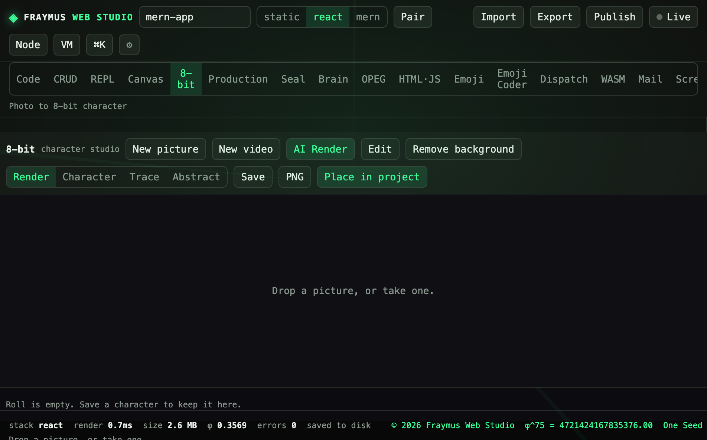
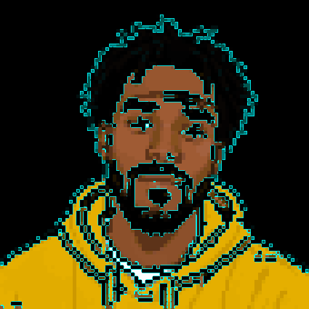
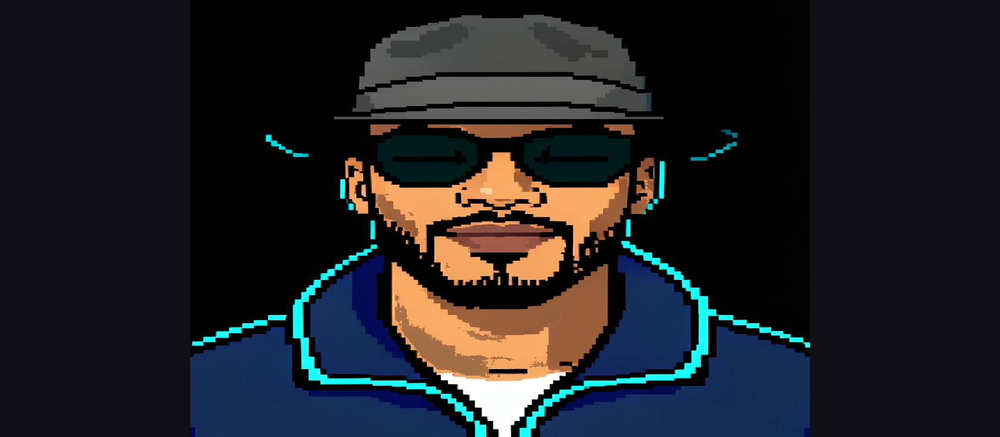
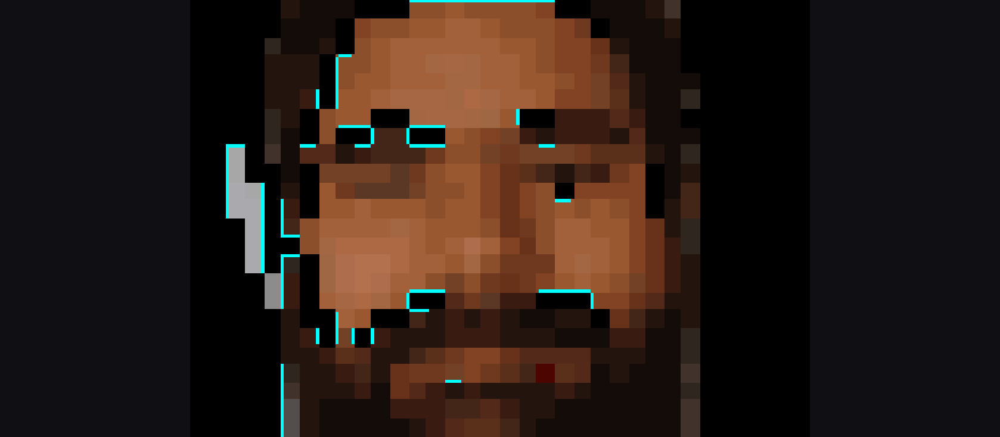

# 8-bit

Photo, camera, or movie to an 8-bit character. Character, Trace, and Abstract are the still views. Style video and Cartoon video are the motion paths. Talk builds four mouth cells. Play and WebM do not call a model.

Module: [`client/src/tools/PixelPage.jsx`](../../client/src/tools/PixelPage.jsx), mouth finder in [`client/src/tools/pixelMouth.js`](../../client/src/tools/pixelMouth.js).

  

## How to run

Open **8-bit**.

| Action | Result |
| --- | --- |
| Drop a picture | Paints the stage, then the pixel views |
| Take one | Uses the camera on this machine. The photo stays in `data/projects/` and is not committed |
| New video | Paints the first readable frame, then starts Style video |
| Style video | Fast pixel filter, 10 frames a second, 2-pixel blocks |
| Cartoon video | Asks the render model for 2 frames a second with one locked seed |
| Talk | Four cells from the sprite |
| Play / WebM | Local playback. No model call |

If the browser cannot decode a movie, `POST /api/pixel/video` runs `avconvert --preset Preset1280x720` and the page opens the MP4. HEIC stills go through `POST /api/pixel/convert`. AI Render uses `POST /api/pixel/render` and a token in `hf-token.txt` or `HF_TOKEN`. That file is gitignored.

## What this run showed

The stage was empty on purpose: **Drop a picture, or take one.** No camera frame was taken for this repository. A face photograph is not part of the git tree.

Earlier pixel figures of the drawn character, the talk cells, and motion are already in the showcase:

  
  
  

The mouth finder looks for the largest flat warm-white tooth component below the eyes, then a wide centered dark lip slit, then a proportion from the eye line to the chin. Sunglasses and jacket cyan are not the eye line.

More: [8-bit status](../8BIT_STATUS.md), [8-bit motion](../8BIT_MOTION.md), [avatar studio](../AVATAR_STUDIO.md).

## Expect

- An empty stage is a valid start.
- Style video updates the stage line: `Opening…`, `Converting…`, or `Styling frame n of m`.
- AI Render fails closed when no token is present. The rest of the tab still runs.

[All tabs](README.md)
