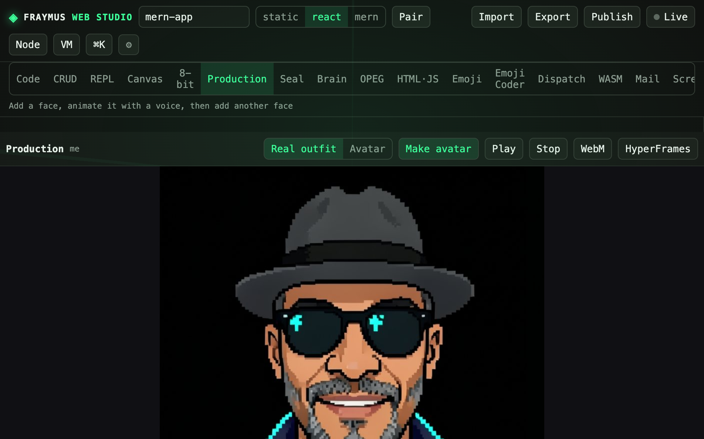

# Production

A cast of 8-bit faces, lines, and voices. The mouth opens on the drawn smile. Idle shows the closed sprite.

Module: [`client/src/tools/StudioPage.jsx`](../../client/src/tools/StudioPage.jsx). `applyCast` writes the cast into the project.

  

## How to run

Open **Production**. Add a face, render an 8-bit sprite, give it lines and a voice. **Play** opens the mouth. **Stop** returns to the closed smile. **WebM** records locally.

## What this run showed

The stage held the saved 8-bit stand-in: hat, sunglasses, cyan rim. **Play**, **Stop**, and **WebM** were on the bar. This figure is pixel art already in the studio, not a new camera photograph.

The cast lives with the project under `data/projects/`, which is gitignored. Do not put a face photo in git.

## Expect

- Idle is the closed original.
- Play uses the cells from the saved sprite. A refresh uses the current mouth finder without Make avatar.
- WebM does not call the render model.

[All tabs](README.md)
