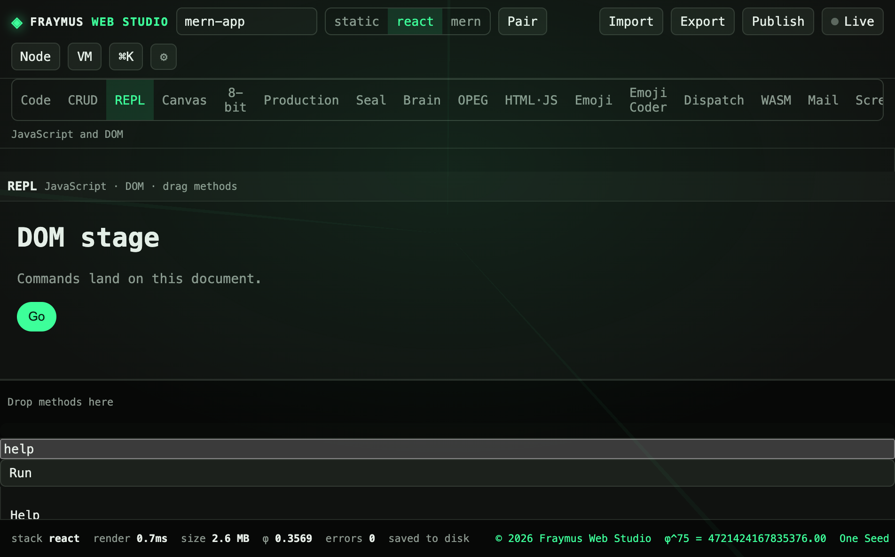

# REPL

A command strip that runs against a DOM stage in an iframe. The stage is a small document, not the studio shell.

Module: [`client/src/tools/ReplPage.jsx`](../../client/src/tools/ReplPage.jsx).

  

## How to run

Open **REPL**. The input starts as `help`. Press **Run**.

The stage heading is `DOM stage`. The copy line is `Commands land on this document.` A **Go** button sits under it.

## Commands

`help` lists this table. Custom methods you add persist in `localStorage` under `fraymus-repl-methods`.

| Command | Form | Role |
| --- | --- | --- |
| `help` | `help [name]` | List commands, or show one |
| `clear` | `clear` | Clear the log |
| `query` | `query(selector)` | First match |
| `queryAll` | `queryAll(selector)` | Count plus tags |
| `text` | `text(selector, value?)` | Read or set `textContent` |
| `html` | `html(selector, value?)` | Read or set `innerHTML` |
| `style` | `style(selector, prop, value?)` | One CSS property |
| `class` | `class(selector, name, on?)` | Toggle a class |
| `attr` | `attr(selector, name, value?)` | Read or set an attribute |
| `create` | `create(tag, parent?)` | Make an element and append it |
| `append` | `append(selector, text)` | Append a text node |
| `remove` | `remove(selector)` | Remove the element |
| `click` | `click(selector)` | Fire a click |
| `focus` | `focus(selector)` | Focus an element |
| `box` | `box(selector)` | `x, y, width, height` |
| `tree` | `tree` | Outline the stage tags |
| `keys` | `keys(objectExpr)` | `Object.keys` |
| `json` | `json(value)` | `JSON.stringify` |
| `range` | `range(n)` | `0..n-1` |
| `sum` | `sum(a, b, ...)` | Add numbers |
| `now` | `now` | Current time |
| `typeof` | `typeof expr` | JavaScript `typeof` |

Premade strips on the page: Fade title, Accent title, Insert card, Grid the stage, Rename heading.

## What this run showed

The input was `help` and **Run** had been pressed. The log listed the command names above. The stage stayed the DOM document: title, lede, Go button.

## Expect

- `text('#title', 'Fraymus stage')` changes the heading in the stage only.
- A missing selector throws `No element for …` into the log.
- Nothing here writes the open project unless you copy a result out yourself.

[All tabs](README.md)
