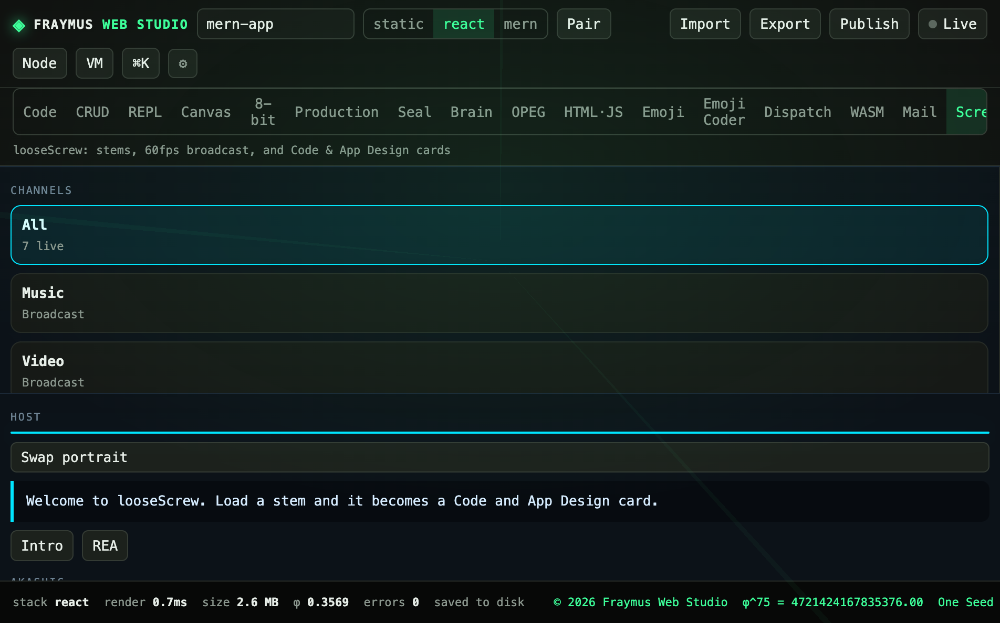

# Screw

looseScrew is the broadcast desk: stems, a 60fps host, and Code & App Design cards. Load a stem and it becomes a card.

Module: [`client/src/tools/LooseScrewPage.jsx`](../../client/src/tools/LooseScrewPage.jsx).

  

## How to run

Open **Screw**. Channels filter the desk: All, Music, Video, Code & App Design. **Intro** and **REA** are host lines. **Play** on a music card starts that stem. **Load stem** brings in another. **Rebuild from project** refreshes the Code cards from the open project.

## What this run showed

| Meter | Value |
| --- | --- |
| All | 7 live |
| Host | EYEO |
| PHI | 1.618 |
| Fossils | 14 |
| LAZARUS CORE | 36.48° |

The host line: `Welcome to looseScrew. Load a stem and it becomes a Code and App Design card.`

Cards on the desk in this run:

| Card | Tempo | Length | Screws |
| --- | --- | --- | --- |
| Phi-Harmonic Sub-Bass (1.618 Hz Drift) | 118 BPM | 03:44 | music toggles: Sub, Lead, Drum, Custom |
| App Design · mern-app | 110 BPM | 09:40 | 8 |
| REA · Project obligation ledger | 96 BPM | 04:32 | 40 |
| Brain · π-hidden 448.49 Hz | 108 BPM | 07:10 | 64 |

Transmissions on the music strip: 7. Alternate tuning on the card: 432 Hz.

## Expect

- All shows every live card. Music and Video filter to those channels.
- Play is local audio. It does not call a remote stream.
- Rebuild from project follows the open project name. This run’s project was `mern-app`.

[All tabs](README.md)
