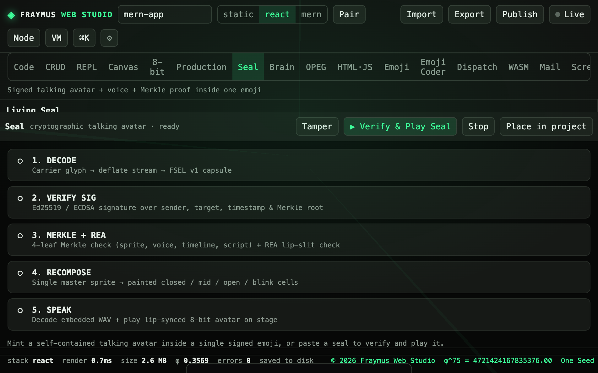
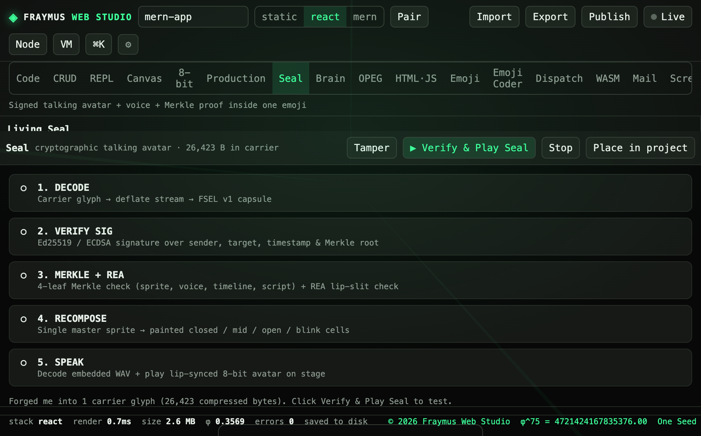
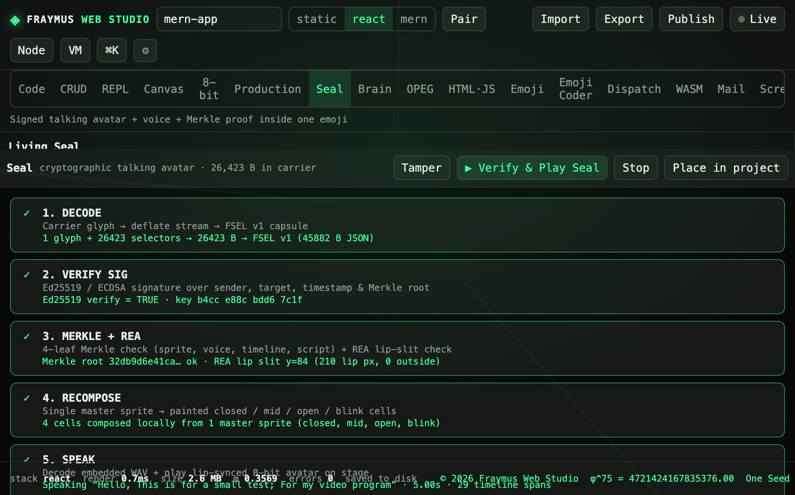

# Seal

One emoji carries the sprite, four mouth cells, a WAV, the lip timeline, a 4-leaf Merkle tree, and an Ed25519 signature. Wire type `FSEL`.

Module: [`client/src/tools/SealPage.jsx`](../../client/src/tools/SealPage.jsx). Notes sit with the [Brain manual](../SOVEREIGN_BRAIN_README.md).

## How to run

Open **Seal**. Forge packs the living seal into one carrier glyph. **Verify & Play Seal** walks five checks, then speaks. **Tamper** flips a byte so a later verify fails. **Place in project** writes the carrier into the open project.

## What this run showed

Idle pipeline, then a forge, then a verify. All five checks passed.

  

Forge status: **26,423 B in carrier**. The line under the steps read: `Forged me into 1 carrier glyph (26,423 compressed bytes).`

  

Verify:

| Step | Result |
| --- | --- |
| 1. DECODE | 1 glyph + 26423 selectors → 26423 B → FSEL v1 (45882 B JSON) |
| 2. VERIFY SIG | Ed25519 verify = TRUE · key `b4cc e88c bdd6 7c1f` |
| 3. MERKLE + REA | root `32db9d6e41ca…` ok · REA lip slit y=84 (210 lip px, 0 outside) |
| 4. RECOMPOSE | 4 cells composed locally from 1 master sprite (closed, mid, open, blink) |
| 5. SPEAK | “Hello, This is for a small test; For my video program” · 5.00s · 29 timeline spans |

  

## Expect

- A fresh forge changes the byte count with the sprite and the script.
- Tamper makes VERIFY SIG or MERKLE fail. The page does not play a broken carrier.
- The signing key in the status line is the session key for that seal, shown so you can see the check. It is not a Hugging Face token and it is not a mailbox password.

[All tabs](README.md)
