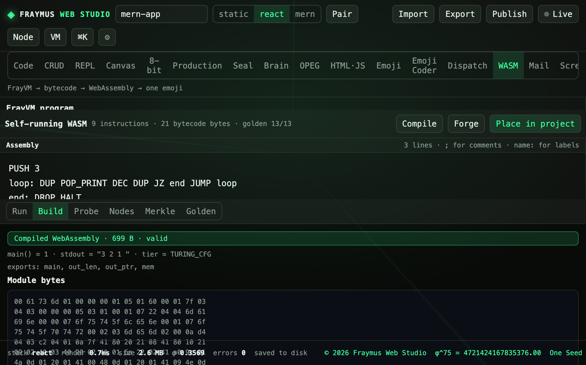

# WASM

FrayVM is a 53-opcode dual-stack machine. Assemble it, run it, compile it to WebAssembly, or forge a self-running module. Straight-line code and Turing-complete `JUMP` / `JZ` loops both compile.

Module: [`client/src/tools/WasmPage.jsx`](../../client/src/tools/WasmPage.jsx). The machine is [`client/src/tools/frayvm.js`](../../client/src/tools/frayvm.js). The ISA is [docs/ISA_SPECIFICATION.md](../ISA_SPECIFICATION.md).

<p align="center">
  
</p>

## How to run

Open **WASM**. Load a preset or type assembly. **Run** executes on FrayVM. **Build** / **Compile** emits a `.wasm` module. **Probe**, **Nodes**, **Merkle**, and **Golden** inspect the module. **Forge** packs a self-running module. **Place in project** writes it into the open project.

Comments are `;`. Labels are `name:`.

## What this run showed

The loaded program was the countdown:

```
PUSH 3
loop: DUP POP_PRINT DEC DUP JZ end JUMP loop
end: DROP HALT
```

| Meter | Value |
| --- | --- |
| Instructions | 9 |
| Bytecode | 21 bytes |
| Golden | 13/13 |
| Module | Compiled WebAssembly · 699 B · valid |
| Tier | `TURING_CFG` |
| stdout | `3 2 1` |

Exports: `main`, `out_len`, `out_ptr`, `mem`. The module bytes start with the WebAssembly magic `00 61 73 6d`.

Presets on the menu, with the results printed beside them:

| Preset | Result |
| --- | --- |
| Add 10 + 5 | 15 |
| Arithmetic (6*7-2) | compiles to WASM |
| Say Hi! | Hi! |
| Count down 3..1 | 3 2 1 |
| Fibonacci < 100 | 0 1 1 2 3 5 8 13 21 34 55 89 |
| Powers of 2 < 1000 | 1 2 4 8 … 512 |
| Squares 1..5 | 1 4 9 16 25 |
| Primes up to 40 | 2 3 5 7 11 … 37 |
| Factors of 24 | 1 2 3 4 6 8 12 24 |
| Factorial 5 | 120 |
| Sum 1..10 | 55 |
| GCD(48, 36) | 12 |
| Instruction set | 60 |

Opcode samples on the card: `HALT 0x00`, `NOP 0x01`, `EMIT 0x10`, `DROP 0x20`, `SWAP 0x21`, `DUP 0x2c`.

A `fray.pcc.v21` certificate can reject a bad signature or an infinite loop before `WebAssembly.Instance`. Figures of that path are in [`docs/showcase/wasm-golden-turing-parity.png`](../showcase/wasm-golden-turing-parity.png) and [`docs/showcase/wasm-turing-cfg-compiler.png`](../showcase/wasm-turing-cfg-compiler.png).

## Expect

- Golden 13/13 means the preset suite matched. A hand-edited program can still compile with a lower golden count.
- An invalid module is marked invalid and is not instantiated.
- Place in project stores the bytes on the project. It does not publish them.

[All tabs](README.md)
